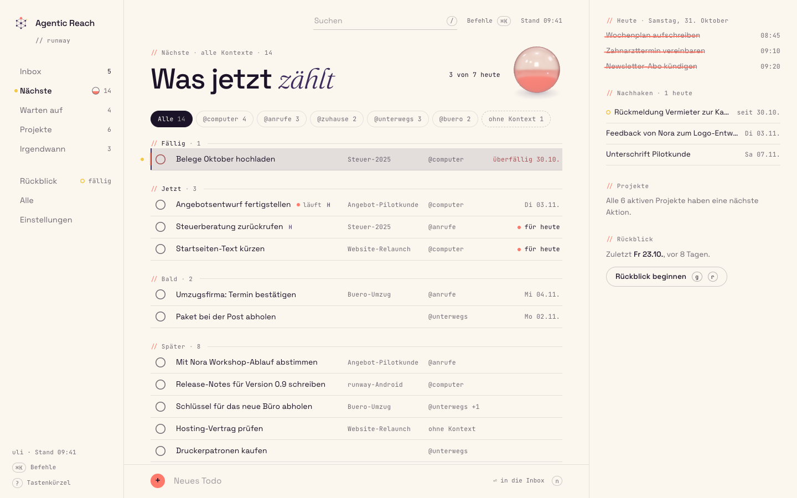
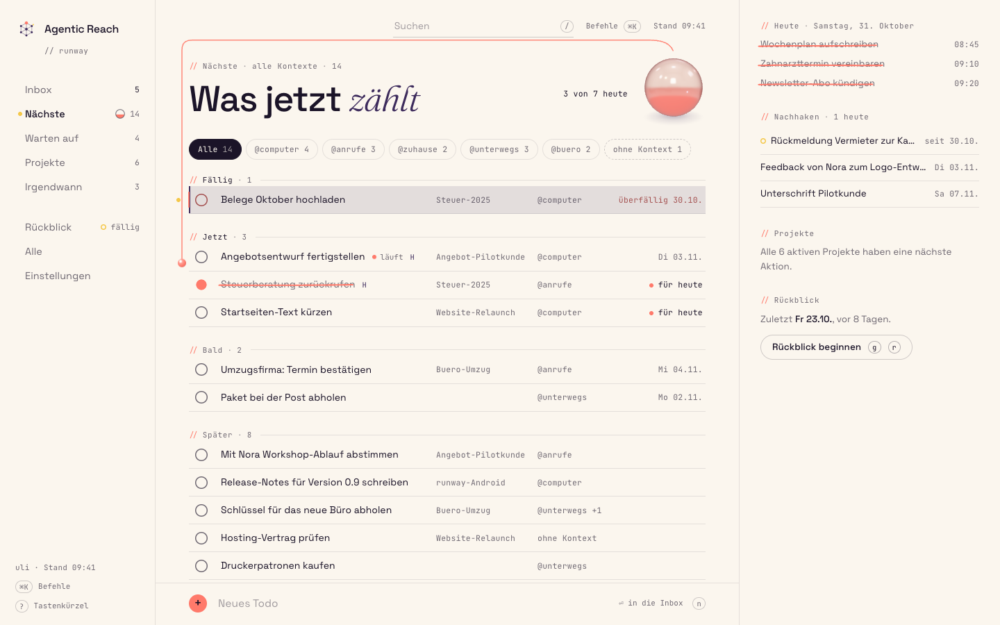
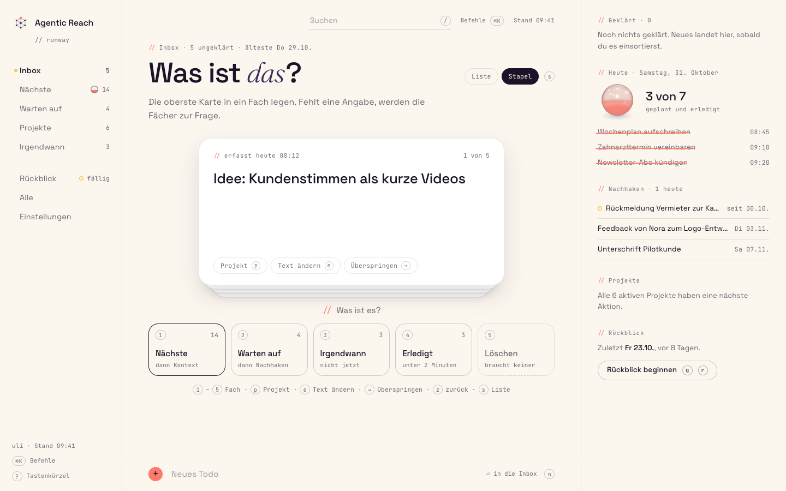
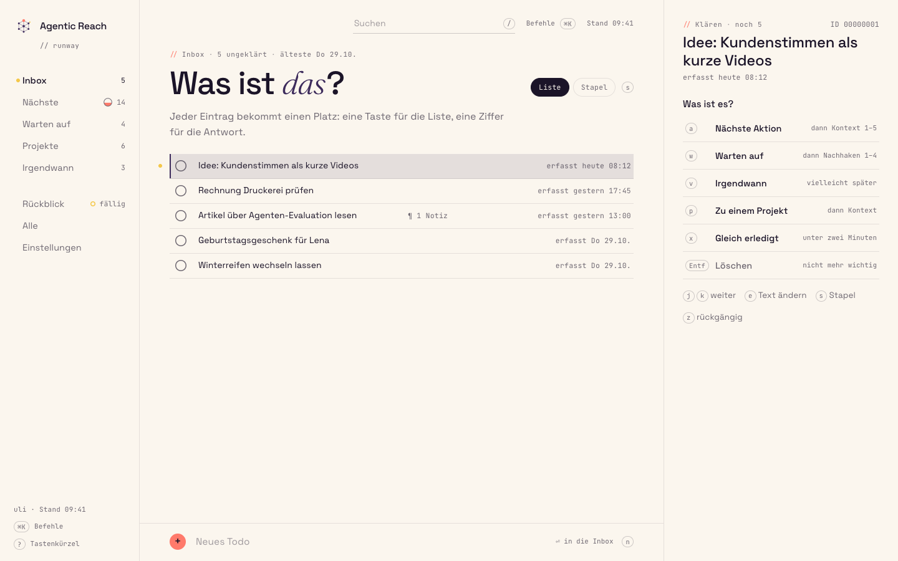
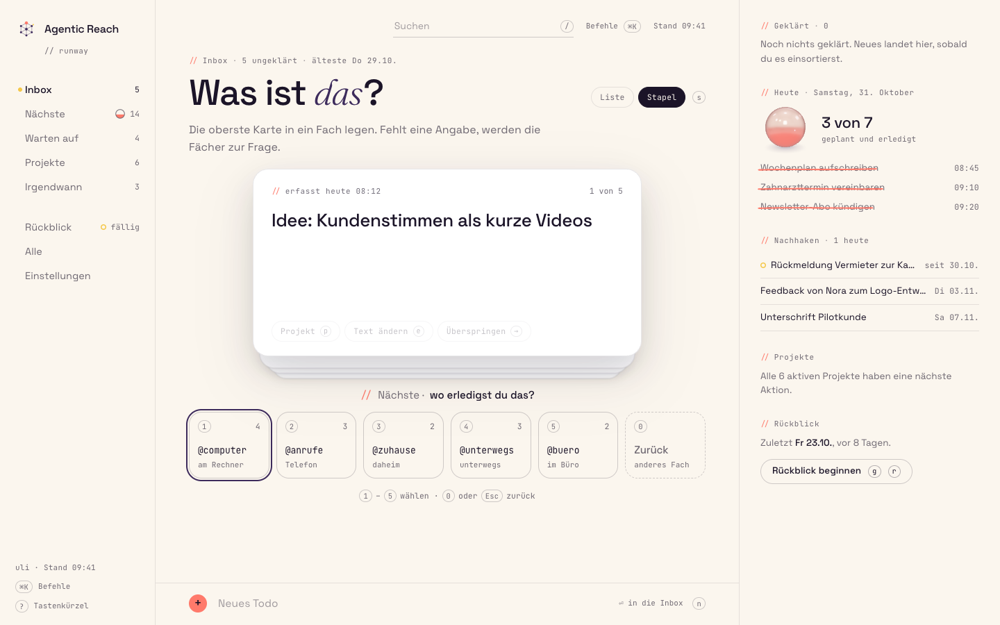
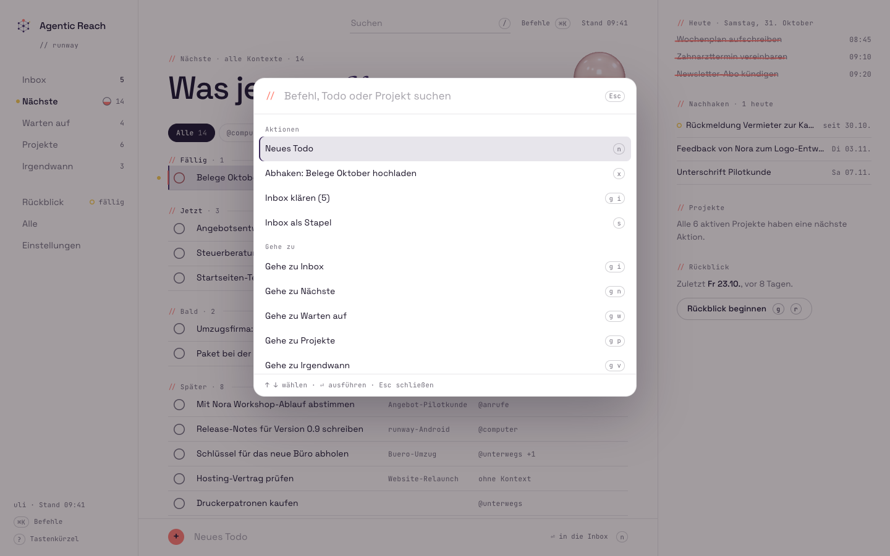
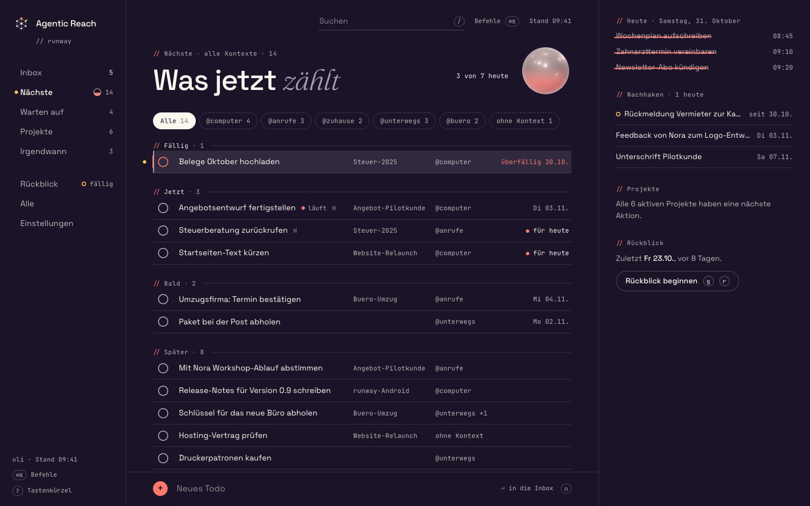
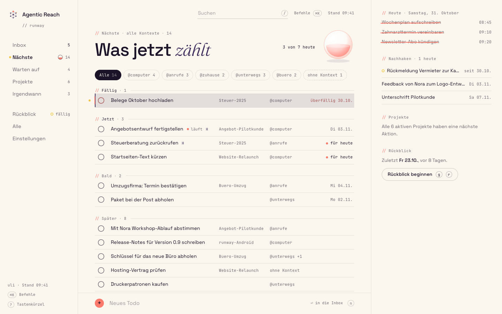
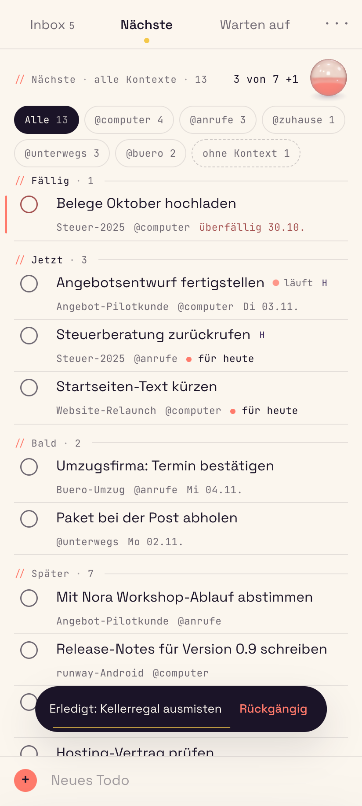
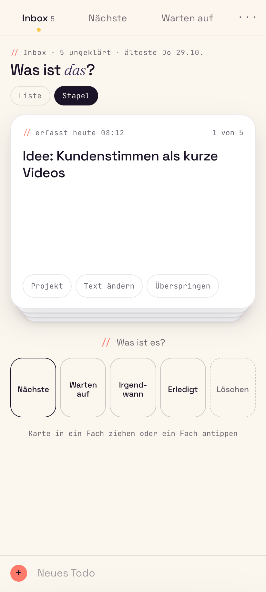

# 06 · Kombination: Papier & Tinte + Tageslinse + Kartenstapel

The web combination Uli chose on 31.10.2026 ("I follow your recommendation, so do the combination of the three"). It implements the judge's recommendation in [../README.md](../README.md#recommendation) as written: 03 Papier & Tinte is the base, 01's Tageslinse is the one persistent 3D object, 05's card stack is the touch Klären mode and an optional desktop mode, plus the smaller grafts from 04 and 02. The mobile app is out of scope here; it gets its own proposals.

[web prototype](index.html) · shots in [shots/](shots/)

| Web · desktop | Signature: bead into the lens | Card stack |
|---|---|---|
|  |  |  |

| Inbox, two-key panel | Stack, trays turned into contexts | Command palette |
|---|---|---|
|  |  |  |

| Dark | Reduced motion (static lens) | Phone web | Phone web, Klären |
|---|---|---|---|
|  |  |  |  |

Further shots: [web-palette-search.png](shots/web-palette-search.png) (search plus "Als Todo erfassen"), [web-outbox.png](shots/web-outbox.png) ("Nicht gesendet · Erneut senden" on the row, in the panel and in the rail), [web-filter.png](shots/web-filter.png) (`proto.filter('@anrufe')`: due items of other contexts under the one "Fällig" heading), [web-phone-dark.png](shots/web-phone-dark.png) (the dark lens at 52 px).

## How to view

From the design folder (`docs/design/2026-10-31-unified-ui/`):

```sh
python3 -m http.server 8340 --bind 127.0.0.1
# http://127.0.0.1:8340/06-kombination/index.html
node --test 06-kombination/rules.test.mjs        # 14 rule tests
node shared/tools/shot.mjs 06-kombination/index.html out.png --eval="void proto.signature()" --wait=1000
```

Things to try: `x` on "Steuerberatung zurückrufen" (planned for today: the bead flies, 3 von 7 becomes 4 von 7), `x` on "Kellerregal ausmisten" (not planned: struck, counted as "1 zusätzlich", no bead), `t` to plan a row for today, `2` / `6` for @anrufe / ohne Kontext, `g i` then `a 1` or `w 2`, `s` for the stack, `⌘K` / `Ctrl+K`, `proto.network(false)` and capture something.

## What came from where

| Part | From | In this prototype |
|---|---|---|
| Shell: rail, page column, margin column ("Randspalte"); phone tabs Inbox · Nächste · Warten auf · ···; docked clarify panel at 761-1180 px | 03 | `web.css` (copy), `web.js` render functions |
| Row anatomy (ring, one line, mono meta in fixed columns, coral edge rule for overdue, läuft pulse), headings with one Fraunces word, `//` eyebrows, coral ink strike on done, notice with the 1 px yellow undo line | 03 | `base.css` (copy), `common.js` |
| Keymap (`g`-sequences, `j k x e s n /`, `?` sheet), two-key clarify panel, list rules with exact inverses (`tags_add` / `tags_remove`), lenient context rule, 6 s hold for done and delete | 03 | `web.js`, `rules.js`, `store.js` |
| Tageslinse: Three.js glass lens, volume-true liquid level = planned progress today, bead flight for planned todos only, stable day-progress rule ("· 1 zusätzlich"), 0 frames idle, static SVG for reduced motion and WebGL failure, 14 px rail ring | 01 | `lens3d.js` (01's `fx3d.js`, lens scene only), `lens-flat.js`, `lens.js`, `rules.js dayProgress` |
| The lens replaces 03's tally: in the Nächste head, and in the margin's "Heute" on every other view; the struck-through "Heute" list stays | judge | `todayPanel`, `renderHead` |
| Inbox card stack: DOM card with CSS 3D springs, five trays with keys 1-5, trays turning into the follow-up answers, Zurück / Esc / 0, drag and flick, Stapel / Liste toggle | 05 | `card.js` (unchanged copy), `stack.js` (redrawn in 03's language, no icon set) |
| "Never guess metadata": Nächste needs a context (the store refuses), Warten auf asks for a follow-up day (next working day "morgen" or "Montag" · Freitag · nächste Woche = the Monday after · ohne Datum, written as `scheduled`); leaving Warten auf clears that day | 05 | `rules.js NeedsAnswer`, clarify panel, stack steps, detail panel ("Nächste braucht einen Kontext") |
| Nächste sections Jetzt · Bald · Später after Fällig, from fields, not from the urgency score | 04 | `rules.js ringOf` |
| "ohne Kontext" chip (key 6) | 04 | context bar, palette |
| ⌘K / Ctrl+K command palette: actions, navigation, contexts, view, todo and project search, "Als Todo erfassen" | 04 | `web.js` palette section, drawn without 04's blur |
| Web write path: captures sent at once (undo = DELETE); done and delete held 6 s, mirrored to IndexedDB, flushed with keepalive on `pagehide` / hidden; visible "Nicht gesendet · Erneut senden" on the row, in the panel, in the rail and in the notice | 02 | `store.js send / hold / flush / retry` |
| "Fällig · andere Kontexte" under an active context filter | 02 | `store.js lists`, `sectionsFor('next')` |
| i18n structure: every string a key, German default | 02 | `i18n.js` (`t()`, 389 keys), `data-i18n` on the static shell |
| Inbox-zero ink bloom | 03 | **cut** (see below) |

### Decisions taken while combining

- **The ink bloom is cut.** The judge allowed it only if it fits cleanly. It does not: on an empty Inbox the margin shows the lens, so the bloom would be a second WebGL canvas on the same screen, against the one-canvas rule. Inbox zero is 03's typographic state ("Inbox ist leer.").
- **One canvas, moving slots.** Each view renders lens slots; `lens.sync()` puts the single WebGL canvas into the slot that is on screen (Nächste head 104 px, margin 72 px; on a phone 52 px in the head, 64 px in the sheet) and draws the static SVG in the others. On Nächste the margin shows only the struck-through "Heute" list, so neither the lens nor "3 von 7" appears twice.
- **Jetzt includes "für heute".** The judge's ring rule (overdue, due today, running, prio H) plus todos planned for today with `t`. So every todo that counts for the lens sits in Fällig or Jetzt, directly under the lens, and the bead's path is always short. The row says "für heute" with a coral dot.
- **The bead's path avoids text.** It leaves the ring into the left gutter, runs up beside the rows, along the free band above the head, and hooks down into the glass (`flyToLens`). It never crosses a row's words.
- **Which mode where.** Desktop opens the Inbox as 03's list with the two-key panel; `s` or the Liste / Stapel toggle switches. Touch screens and phone width open it as the stack. Both modes call the same `store.clarify` with the same payloads.
- **Clarify keys after the graft.** `a` then 1-5 (no "überall" any more), `w` then 1-4 (follow-up day), `p` then 1-9 then 1-5 (project, then its first action's context), `p n` for a new project, `v`, `x`, `Entf`. In the stack: 1-5 trays, then the answer, `p` project (its last option is "Neues Projekt"), `e` edit, `→` skip.
- **Writes.** Clarify and list moves go out at once and Rückgängig sends 03's exact inverse (now including `scheduled`); captures go out at once and Rückgängig sends DELETE; done and delete wait 6 s because the API cannot reopen or undelete.

## Nächste, the most used screen

`// Fällig` (due today or earlier, any context) · `// Fällig · andere Kontexte` (only with a context filter; unranked; when the filtered context has nothing due, these rows sit under the one `// Fällig · N · andere Kontexte` heading instead) · `// Jetzt` · `// Bald` · `// Später`. Lenient context rule: a filter shows its context plus todos without one; "ohne Kontext" shows only those. Order inside a section: running first, then priority H, then urgency (the number is never shown). Head: eyebrow with list, filter and the chip's own count (`@anrufe · 3 · +1 ohne Kontext`); "Was jetzt *zählt*" (screen-reader only on a phone); the lens with "3 von 7 heute" beside it; context chips that wrap, never scroll. On Nächste the margin's "Heute" shows only the struck-through list, so "3 von 7" appears once.

## Three.js: what it shows and what it costs

| Effect | Explains | Web | Fallback |
|---|---|---|---|
| Tageslinse level | planned and done today / all planned today (due ≤ today, `scheduled` ≤ today, started); unplanned completions counted apart as "· N zusätzlich" | `MeshPhysicalMaterial` glass (transmission, IOR 1.45, coral attenuation, clearcoat), fresnel rim shader, coral liquid = clipped sphere + surface disc, volume-true level, `RoomEnvironment`, `NeutralToneMapping`; dark theme: frosted plum-light body tinted toward coral, coral attenuation, weak clearcoat and environment (no chrome look) | static SVG lens with the same level; caption in the DOM |
| Bead along the thread | this todo counted for today, and where it went | DOM bead on an SVG path, handed over at the sphere's projected top to a 3D bead that falls into the liquid; one damped wobble; level spring | no flight; ring fill, strike and caption update |
| Level drains on Rückgängig, rises on `t` | the plan or the progress changed | level spring | instant |
| Card lift, tilt, flight, rise (stack) | which tray the item went to | CSS 3D springs on DOM (card.js), no WebGL | the card moves without animation |

Measured in Chromium: 1 frame when the canvas mounts or moves to another slot, **0 frames idle** (checked over 3 s), **48 frames per planned completion**; the rendering loop stops when nothing moves and when the tab is hidden. Three.js is imported only after first paint and only when a lens slot is on screen; the Inbox in list mode has no canvas at all. No text in WebGL. `proto.signature()` runs the moment at a quarter of its speed so a still image can catch the bead.

## Test hook

`window.proto` as in `shared/README.md`: `show(view)`, `filter(context)` (also `'ohne Kontext'`), `capture(text)`, `open(id)`, `complete(id)`, `clarify(id, to)` with `to` = `'next:@ctx'` | `'waiting'` (asks for the day) | `'waiting:2026-11-06'` | `'someday'` | `'project:Name'` (asks for the context) | `'done'` | `'delete'`, `signature()`. Extras: `stack()`, `lift()` (drags the top card towards Nächste so the trays turn into contexts), `palette(query)`, `network(up)`, `theme('light' | 'dark' | '')`, `lens` (`{ state, frames, level, caption }`), `stackFrames`, `store`, `ui`, `calls` (every request the real client would send).

## Build plan for the Vue app (frontend/, Vue 3 + Tailwind + Pinia)

1. **Tokens and fonts** as in 03's plan (`tokens.json` → `tokens.css`, Tailwind theme, `RunwayTokens.kt`). The tokens here are 03's, unchanged (`tokens/`).
2. **Shared rules** in `src/shared/`: `listMoves.js` (this `rules.js`: list membership, clarify / list / context payloads, exact inverses, `NeedsAnswer`), `sections.js` (`ringOf`), `dayProgress.js`. Tests in `frontend/tests/` from `rules.test.mjs`; the same vectors as JSON for the Kotlin port.
3. **Shell components** from 03: `AppShell` (RailNav, PhoneTabs, Randspalte as column / docked panel / overlay / sheet), `ListPage`, `ListSection`, `TaskLine` (keyed, `InkStrike`), `ContextBar` (with "ohne Kontext"), `CaptureLine`, `NoticeBar`, `TaskDetail`, `ClarifyPanel` (with the follow-up and context questions), `TodayPanel`, `ProjectsPage`, `PlanDocument`, `ReviewView`, `ShortcutsSheet`.
4. **`TagesLinse.vue` + `useLens()`**: one module-level renderer; components render `<LensSlot size>`; a watcher after each route / layout change moves the canvas to the visible slot. `lens3d.js` is a separate Vite chunk (`three` + `RoomEnvironment` only), imported in idle time when a slot is on screen; `prefers-reduced-motion`, no WebGL or `webglcontextlost` keep `LensFlat.vue`. A unit test pins that no other chunk imports `three` and that at most one canvas exists.
5. **`BeadFlight.vue`**: an overlay SVG plus one bead, driven by `useBeadFlight(fromEl)`; only when `dayProgress` says the todo counts and a slot is visible.
6. **`CardStack.vue` + `useCardSpring()`** (port of `card.js`), `StackTrays.vue`; the stack calls the same store action as `ClarifyPanel`. Inbox mode in `localStorage` per device, default by `(pointer: coarse)`.
7. **`CommandPalette.vue`** with a command registry shared with `useKeymap` (one table generates the palette entries, the `?` sheet and the key handlers).
8. **Write path**: `useOutbox()` in `fe/tasks`: send-now for captures and moves, 6 s hold for done / delete, IndexedDB mirror (`idb-keyval`-sized helper, guarded), `fetch(..., { keepalive: true })` flush on `pagehide` / hidden, failed ops with retry; `TaskLine` and the rail read the per-row sync state.
9. **i18n**: `src/i18n/de.js` with these keys behind `vue-i18n` (or a 20-line `t()`); a test compares the strings Android pins.
10. **Freshness**: today neither client refreshes on focus or polls (inventory 2.10). `useFreshness()` refetches the lists on `visibilitychange` (visible) and `window` focus, at most once per 30 s, sets "Stand hh:mm", and recomputes `dayProgress` after it; the lens animates only if the numbers changed (a new due date arriving changes the denominator, by the stable rule).
11. **Routes**: `/inbox`, `/next`, `/waiting`, `/someday`, `/projects[/name]`, `/all`, `/review`, `/settings`, `?task=<uuid>` for the Android handoff (03).

## Effort (person-days, web only)

Re-estimated after review (the first table was tuned to land in the judge's range).

| Item | Days |
|---|---|
| 03 base as planned (tokens, shell, rows, keymap, panels, projects, review, settings, search, routes, QA) without InkSurface | 25.5 |
| Tageslinse: lazy chunk, transmission-glass material, slot manager, dark tuning, SVG fallback, context loss, frame budget test | 5 |
| Bead flight and the "für heute" plan toggle (`t`, detail, palette) | 1.5 |
| Card stack (springs, trays, steps incl. new project, drag and flick on touch and mouse, undo return, touch layout) | 6 |
| Never guess metadata (store refusal, follow-up question, context question in panel, detail and project add) | 1 |
| Jetzt · Bald · Später, ohne Kontext, Fällig · andere Kontexte | 1 |
| Command palette with the shared command registry | 2 |
| Write path increment over 03 (IndexedDB mirror, keepalive flush, per-row failed state, retry UI, list-move inverses) | 3 |
| i18n keys with vue-i18n and the shared-strings test (increment over 03) | 0.5 |
| Safari / WebKit QA (transmission cost, `preserve-3d`, `keepalive`, IndexedDB in private mode) | 1.5 |
| Contingency (10 %) | 4.7 |
| **Total** | **≈ 52** |
| Backend: handoff endpoints for the Android Custom Tab (only if approved) | 1 |

**This is about 6 days over the judge's 38-46.** To stay at 46, cut in this order (v1, added later without rework):

1. Stapel as a desktop mode (touch only; desktop keeps the two-key panel): −1.
2. Drag and flick in the stack (tap a tray, keys 1-5 stay): −1.5.
3. Palette search over todos and projects (actions, navigation and contexts stay; `/` search exists): −1.
4. IndexedDB mirror of the held queue (keepalive flush on `pagehide` stays): −1.
5. Contingency on the smaller scope: −0.6.

That gives ≈ 46.5. The lens, the bead and the write path's visible failures are not on the cut list: they are what the combination is for.

No backend change is needed for the grafts: `scheduled` is already a task field, and the sections and the day progress are client rules.

## Brand deviations (need Uli's approval)

1. **Ink text on coral pills** (7.0:1 instead of the kit's white at 2.5:1). From 03.
2. **Coral as the overdue and error signal**, including "Nicht gesendet". The brand has no red. From 03 and 02.
3. **Coral as "done" ink and as the lens liquid and bead.** Completing is the app's primary action; the strike, the bead and the liquid are its trace. The "für heute" dot is coral for the same reason.
4. **One glass object with shading gradients inside it** (the Tageslinse, its SVG fallback and the bead), against "no glassmorphism, no gradients". It is a depicted object that carries a number, not a UI surface; nothing else in the app has glass or gradients. From 01.
5. **Plum-light on dark** (plum mixed into off-white) for accents and focus. From 03.
6. **Fraunces beyond the accent word** for project outcomes and the plan vision. From 03.
7. **Mixed-case mono eyebrows** (Android pins exact strings). From 03.
8. **Pill keycaps** as a recurring hint element, hidden on touch. From 03.
9. **German only.** The kit asks for `data-i18n` with `de` and `en`. Every string is a key in one table and the static shell carries `data-i18n`, but v1 ships only `de` (Uli's decision; Android's tests pin German).

Deviations of the source proposals that this combination does **not** take: 01's and 05's own glyph sets (no icons here; mono symbols only), the "runway by Agentic Reach" lockup (the kit's mark + "Agentic Reach" with `// runway`, as in 03), 04's blur behind the palette, 05's companion derived from the mark, 03's watercolour ink bloom.

## Open questions for Uli

1. **Do you plan days?** The lens counts due todos, todos planned with `t` and started ones. Without the `t` habit it shows only the due items. Keep `t`, or use a `+today` tag instead?
2. **Jetzt includes "für heute".** Fine, or keep Jetzt to overdue / due today / running / prio H only?
3. **Inbox default by device** (desktop list, touch stack). Or the stack everywhere?
4. **Ink bloom cut.** Agreed, or a non-WebGL version (CSS ink) for inbox zero?
5. **Writes:** moves and captures go out at once with an inverse or DELETE as undo; only done and delete wait 6 s. Or hold every write 6 s like 02?
6. **A project's next action needs a context** (inline add, plan "→ Nächste"). Agreed?
7. Brand deviations 1-9 above, especially 3 (coral for done) and 4 (one glass object).
8. English as a second table now, or later?

## Known weaknesses

- On Nächste the lens scrolls away with the head. Planned todos sit at the top (Fällig, Jetzt), so the bead almost always has a visible target; when it does not, the completion has no flight and the lens catches up when it scrolls back.
- On dark the glass is now a warm frosted body instead of grey metal, but it is still the weaker of the two lenses: less transparent, because full transmission over ink reads as a hole.
- The bead flight, the CSS 3D stack and the lens were checked in Chromium only (desktop, 1024 px, 412 px phone). Safari needs a check of `transmission` cost and `preserve-3d`.
- The phone head still costs about 150 CSS px below the tabs before the first row (eyebrow and lens band, two lines of chips); the chips must wrap (Android pins all chips visible), so only a collapse-on-scroll would win more.
- Phone rows are about 59 px with two lines (title, then meta); a one-line row with inline meta did not fit at 412 px with project and context.
- The transport is simulated: `proto.network(false)` makes requests fail; the IndexedDB mirror keeps only the held queue's metadata.
- Projekte, Rückblick, Einstellungen and the plan document are 03's, only moved to message keys.

## Files

`index.html` (shell), `web.js` (views, keymap, palette, bead flight, test hook), `store.js` (lists, day progress, write path), `rules.js` + `rules.test.mjs` (pure rules), `lens.js` / `lens3d.js` / `lens-flat.js` (Tageslinse), `stack.js` / `card.js` (card stack), `common.js` (formatting, strike), `i18n.js` (message table), `base.css` / `web.css` (03, copied), `combo.css` (the grafts), `tokens/` (03's token pipeline, unchanged), `shots/`.

## Changes after review

An independent critic scored this 7-8.5 and found the phone web side weaker than the desktop. Fixed:

**Must fix**

1. **Phone undo notice off-screen.** `combo.css`'s ≤1180 px `left` also matched phones. The ≤760 px block now sets `left: 50%; max-width: calc(100vw - 32px)`; "Rückgängig" sits inside the viewport ([web-phone.png](shots/web-phone.png), taken with `proto.complete('14')`).
2. **No capture field in the phone stack.** The rule hiding `.capture` in stack mode is gone; "Neues Todo" stays docked at the bottom below the trays ([web-phone-stack.png](shots/web-phone-stack.png)).
3. **Warten auf → Nächste kept the follow-up as a plan.** `listPayload` now sends `scheduled: ''` when a move leaves Warten auf (the API clears with `''`, `backend/app/routers/tasks.py:129`); `inversePayload` adds back removed tags and restores the day. List moves now show a notice with Rückgängig that sends the exact inverse. Two new tests: the payload and inverse vectors, and a store test that the lens stays at 3 von 7.
4. **"Fällig · 0 / Nichts fällig" above "Fällig · andere Kontexte".** When the filtered context has nothing due, the other contexts' due rows sit under the single "Fällig" heading with an "andere Kontexte" note ([web-filter.png](shots/web-filter.png)).
5. **Eyebrow and chip counts disagreed.** The eyebrow now shows the chip's count and names the lenient extra: `@anrufe · 3 · +1 ohne Kontext`.
6. **Dark lens looked like metal.** Dark branch: frosted plum-light body tinted toward coral, coral attenuation, clearcoat 0.55 and rough, environment 0.5, no iridescence ([web-dark.png](shots/web-dark.png), [web-phone-dark.png](shots/web-phone-dark.png) at 52 px).
7. **"3 von 7" twice on Nächste.** On Nächste the margin keeps only the struck-through "Heute" list.
8. **Effort tuned to the range.** Re-estimated at ≈ 52 pd (lens 5, stack 6, write path 3, WebKit QA 1.5, 10 % contingency), with a named cut list down to ≈ 46.5.

**Nice to have, taken**

- Phone Nächste head: the display heading is screen-reader only at phone width; eyebrow, "3 von 7" and a 52 px lens share one band. The first section starts about 205 CSS px from the top (was 247).
- Phone rows: one non-wrapping meta line, tighter padding; about 59 px instead of 69 (one more row per screen).
- Tray counts hidden on touch.
- Follow-up answers: "morgen" is the next working day ("Montag" on Friday and the weekend), "nächste Woche" is the Monday after it; Friday moves a week when it equals "morgen".
- Rail-foot outbox line: one line, coral, left-aligned, no yellow ring ("1 nicht gesendet · senden", full label in `aria-label`).
- Stack project step: the last option (at most 9) is "Neues Projekt" with a name field, then the context question.
- Build plan item 10: refresh on `visibilitychange` and focus, lens recomputed after it.
- `scheduled: ''` confirmed against the backend before the inverse relies on it.
- Signature still: taken without awaiting `proto.signature()`, so it shows the whole thread from the row through the gutter to the lens.

**Not taken**

- Collapsing the phone head on scroll: the static reduction above got most of the gain; a scroll-linked head is left for the Vue build.
- Meta on the title line on phone: at 412 px it fits only for rows without a project, so it would make row heights uneven.

