# runway unified UI: chosen web design and mobile proposals

Overview of the runway design work for web (Vue 3) and Android (Jetpack Compose), in Agentic Reach branding. Round 2 comes first: the web design Uli chose on 31.10.2026 (the combination of 03, 01 and 05) and five mobile proposals without 3D, ordered by the judge's ranking. Round 1 (the five original proposals) follows below, unchanged. The same content as a page: [index.html](index.html).

## How to view the prototypes

The prototypes use ES modules and need an HTTP server. From this folder:

```sh
python3 -m http.server 8340 --bind 127.0.0.1
```

Then open <http://127.0.0.1:8340/> for this overview, the chosen web design at <http://127.0.0.1:8340/06-kombination/index.html>, or a mobile proposal such as <http://127.0.0.1:8340/mobile/m3-papier-mobil/index.html>. Shared assets, demo data, the `window.proto` test hook and the screenshot tool are described in [shared/README.md](shared/README.md); what both apps do today is in [shared/inventory.md](shared/inventory.md).

## Chosen web design: Kombination

`06-kombination` · [web prototype](06-kombination/index.html) · [README](06-kombination/README.md)

Papier & Tinte with one piece of glass and a stack of cards: 03's editorial page and keymap, 01's Tageslinse as the single WebGL object, 05's card stack for touch Klären, plus 04's sections and ⌘K palette and 02's write path.

| Web · desktop | Signature: bead into the lens |
|---|---|
| 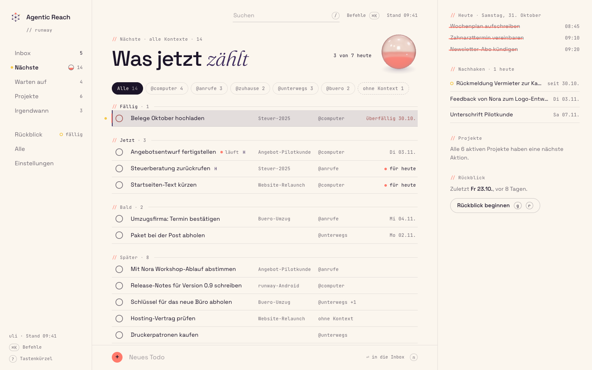 | 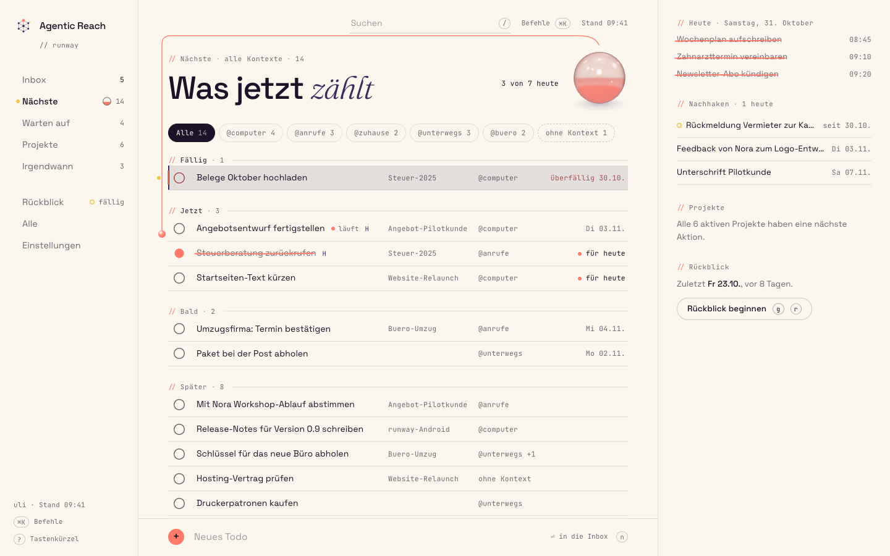 |

| Card stack (Stapel) | ⌘K palette |
|---|---|
| 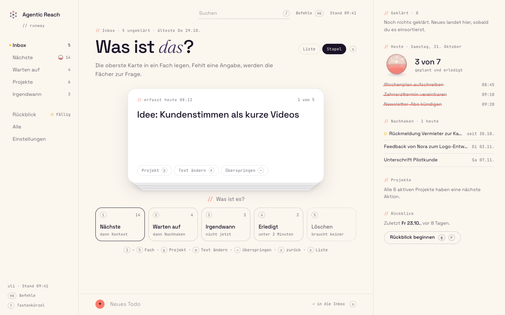 | 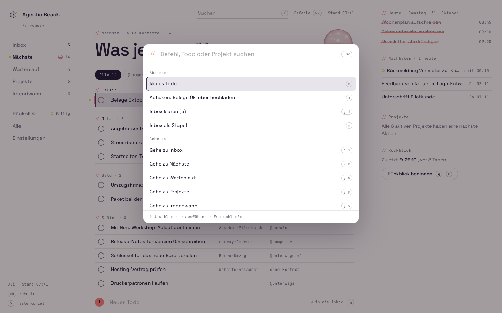 |

**Judge: state of the combination**

06-kombination delivers the recommendation as written:
- 03's shell, rows and keymap;
- 01's Tageslinse as the single WebGL canvas, moving between slots: 0 frames idle, 48 per planned completion, an SVG fallback, and the bead only for planned todos;
- 05's card stack as the touch Klären mode, with 'never guess metadata' enforced in the store;
- 04's Jetzt/Bald/Später sections, the 'ohne Kontext' chip and the ⌘K palette (drawn without blur);
- 02's write path with visible 'Nicht gesendet · Erneut senden' and i18n keys;
- 14 rule tests, including the scheduled-clearing inverse.

The ink bloom was cut for the right reason (a second canvas). The desktop (web-desktop.png, web-signature.png) is close to Linear density with a calm margin column. My estimate: efficiency 8, ease of use 7.5, brand fit 7.5, consistency 8.5, feasibility 6.5.

**Still weak:**

1. Phone web lags. At 412 px the tabs are still at the top, and the undo notice now sits inside the viewport but floats over the list. In judge/06-phone-undo.png it covers the 'Hosting-Vertrag prüfen' row and its ring for 6 s, which is the defect every mobile proposal fixed. The head still costs about 205 px before Fällig, and phone rows are about 59 px. Phone web should adopt the mobile base's bottom dock, with notice, chips, tabs and field in the flow.
2. On the phone, 'Erledigt: Kellerregal ausmisten' repeats the row text, while Android pins 'Erledigt' without it. Only m2 got this exactly right.
3. '3 von 7 +1' on the phone is cryptic; the desktop's '· 1 zusätzlich' wording should be used everywhere.
4. In light mode the lens reads as a peach ball with a pink liquid rather than glass. It works as a number carrier, not yet as delight.
5. The context set (@anrufe/@zuhause/@unterwegs/@buero) does not match Android's @home/@computer/@work/@business. The cross-client story is unresolved until Uli decides.
6. The stack card is about 60 % empty white space above three small buttons (judge/06-phone-inbox.png). It could show the note or the capture source.
7. Effort is ≈ 52 pd, 6 over the judge's range. The cut list reaches 46.5, which is honest. Safari/WebKit (transmission, preserve-3d, keepalive) is still unverified.

## Mobile proposals (no 3D)

Android only, no shader and no Three.js. Each proposal keeps the Agentic Reach look of the web design and optimises for taps, reach and calm. Tap counts are the judge's own (T1 capture, T2 tick off, T3 what now, T4 waiting for, T5 clear the Inbox). Ranking:

1. [Papier mobil](#1-papier-mobil) (`m3-papier-mobil`), average 7.7
2. [Jetzt](#2-jetzt) (`m2-jetzt`), average 7.2
3. [Überall](#3-überall) (`m5-ueberall`), average 6.9
4. [Gesten](#4-gesten) (`m4-gesten`), average 6.7
5. [Daumenzone](#5-daumenzone) (`m1-daumenzone`), average 6.3

### 1. Papier mobil

`m3-papier-mobil` · [mobile prototype](mobile/m3-papier-mobil/index.html) · [README](mobile/m3-papier-mobil/README.md)

The web page split along the thumb: read at the top, and undo, chips, three tabs and the 'Neues Todo' field (on every tab) in the bottom third, with a trailing check ring.

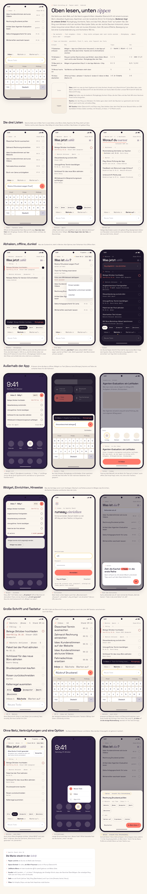

**Scores:** Efficiency 7 · Ease of use 7.5 · Brand fit 8.5 · Consistency with web 8.5 · Contract compliance 6.5 · Feasibility 8 · average 7.7

**Taps:** My count from the home screen, warm. T1: icon + Enter = 2 (field already focused); widget '+' + Enter = 2; tile: swipe + 2; share: Teilen + runway + In Inbox = 3; on Nächste or Warten auf: field + Enter = 2 (today 3). T2: 1 (+1 to undo). The trailing ring is easy in the lower two thirds; top rows need a stretch or a swipe, which the README now admits. T3: icon + Nächste + chip = 3, or 2 with the remembered chip (CC4); widget glance = 0. T4: icon + Warten auf = 2. T5: icon = 1, then per item tick 1, delete 2, edit 3.

**Effort:** 16-20 (README says 14, which is too low for a bottom dock with IME handling, heading fold, banners and 9 contract negotiations) pd

**Strengths**

- The closest sibling of 06: same row, eyebrows, one Fraunces word, hairlines, coral strike, notice with the yellow line. A user moving between phone web and Android sees one product.
- The notice is in the layout flow, so it pushes the list up instead of covering a row. Measured: 5 inbox rows with the notice at a 336 dp IME, and 5 at 150 %.
- The capture field is on every tab, Fällig appears once (dedupe), and the heading folds away with the IME, on scroll and at >= 130 % font. It is dense without being cramped.
- The Mehr menu is fixed. My own shot (judge/m3-mehr.png) shows every pinned item: Angemeldet als, Projekte im Web, Irgendwann im Web, Widget hinzufügen, Protokoll exportieren, Abmelden.
- Lowest risk and lowest effort of the five, with no new surfaces and no gesture system.

**Weaknesses**

- The tally ('|||| 4') in the heading is 03's, but 06 replaced the tally with the lens. On the phone it is now a third vocabulary for today's progress.
- Nächste uses Fällig + one flat 'Nächste Aktionen' list. It does not use 06's Jetzt · Bald · Später sections, so the most-used screen is ordered differently on phone and web.
- The QS tile is drawn as a coral brand tile (board, 'Außerhalb der App'). Android draws QS tiles in system colours, so this is the same misrepresentation m5 was criticised for in round 1.
- The Inbox row menu is still a dropdown at the row edge that covers the row's text (offline frame). m1/m4/m5 moved it into a bottom sheet in thumb reach.
- The quick-clarify option offers a bare 'Nächste' chip without a context. That breaks the 'never guess metadata' rule Uli accepted for the web combination.
- The trailing ring differs from the web's leading ring, so muscle memory does not carry over between clients.

**Contract changes**

1. Tab row moves from the top to above the capture field
2. Context chips sit below the list (P08 wording 'topmost content below the chips' needs an edit)
3. Capture field also on Nächste and Warten auf (a second 'Neues Todo' node)
4. Remembered context chip across process death (until midnight)
5. Mehr gains 'Projekte im Web' and 'Irgendwann im Web'
6. Brand colours replace dynamic colour in app, overlay, share card and widget
7. A due +next task shows only under Fällig
8. Check ring at the trailing edge (driver must find it by contentDescription)
9. Notice in the layout flow, between list and chips

### 2. Jetzt

`m2-jetzt` · [mobile prototype](mobile/m2-jetzt/index.html) · [README](mobile/m2-jetzt/README.md)

The app opens on one calm 'Jetzt' screen (Fällig + the top three next actions in the remembered context, bottom-anchored above tabs and a focused field), with Inbox, Nächste and Warten auf one tab away.

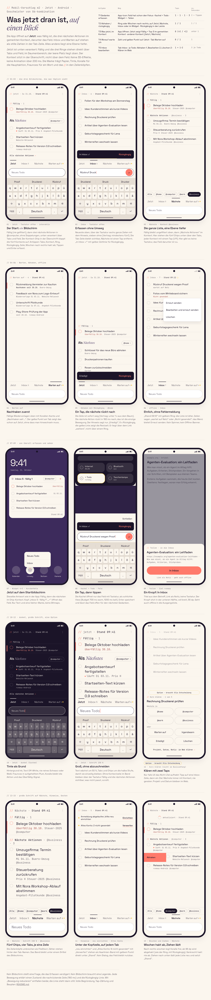

**Scores:** Efficiency 8 · Ease of use 7.5 · Brand fit 8 · Consistency with web 7.5 · Contract compliance 5 · Feasibility 7 · average 7.2

**Taps:** My count. T1: icon + Enter = 2; widget '+' + Enter = 2; tile: swipe + 2; share 3. T2: 1 (+1 undo). The rings are on the leading edge, which is a stretch for a right thumb; with the keyboard up (how Jetzt opens) they sit at y 160-415 dp. T3: icon = 1. This is the only proposal where 'what now in my context' is answered by opening the app; changing context costs +2 (chip in the heading, then the context). T4: the count and yellow dot are visible on open (1 for awareness), list = 2. T5: icon + Inbox tab = 2, then per item tick 1, delete 2, edit 2 + Enter.

**Effort:** 24-28 (+4 for the optional Kurz klären) pd

**Strengths**

- It is the best answer to T3 of all five. Opening the app shows the overdue item plus three different next actions, with the reason in the meta (läuft, date, Prio H).
- Calmest screen of the five. Dedupe means the three slots are never the same todo twice. Nothing on Jetzt asks a question.
- Strict on pinned notices: 'Erledigt' + 'Rückgängig' exactly, without the row text.
- The widget shows the same Jetzt model, so the home screen and the app give the same answer.
- Its vocabulary matches 06: the web's Nächste already has a 'Jetzt' section, so 'Jetzt' means the same on both clients.

**Weaknesses**

- It changes the start screen and adds a fourth tab. done-bar.md (frozen by SHA-256) says 'App-Icon: 1 Tap öffnet die Inbox', and P04/P08/P09 drivers break. This is the most expensive contract change of the five in political terms.
- At 150 % (board frame 11) the third next action 'Release-Notes für Version 0.9 schreiben' is clipped by the tab row: its second line sits on the tab underline. That is a visible overlap in the proposal's own accessibility proof.
- The leading ring and the Jetzt rings sit in the upper half whenever the keyboard is up, which is how Jetzt opens. So the thumb-zone claim holds only with the keyboard closed.
- The Inbox row menu is still the dropdown at the row edge (frame 06), covering the row text.
- The banner reads 'Anmeldung abgelaufen, bitte neu einrichten'. That passes the 'contains neu einrichten' driver but silently rewords the app's 'Key abgelehnt – neu einrichten'.
- A capture on Jetzt never shows the item, only the notice and the count.

**Contract changes**

1. Start screen Jetzt instead of Inbox (done-bar U2 re-freeze by Uli)
2. Fourth tab Jetzt; the tab row moves to the bottom band; Mehr moves to the top line
3. Jetzt shows its own Fällig heading
4. Dedupe of due next actions
5. Context remembered across process death, shared by Jetzt and Nächste
6. Widget shows Jetzt; receiver label 'runway Jetzt'; one vector mark in the header
7. Brand colours replace dynamic colour; overdue coral-based (pixel hue test)
8. Band controls scale at half the font-scale step

### 3. Überall

`m5-ueberall` · [mobile prototype](mobile/m5-ueberall/index.html) · [README](mobile/m5-ueberall/README.md)

Capture and glance move out of the app: a home-screen widget with a capture bar, the tile, optional quiet notification with direct reply, pinnable shortcuts and share, while the app becomes a lean bottom-dock list.

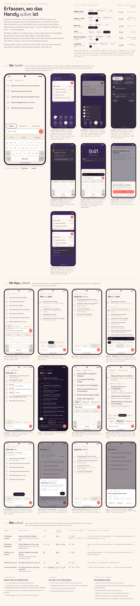

**Scores:** Efficiency 7.5 · Ease of use 7 · Brand fit 7.5 · Consistency with web 7.5 · Contract compliance 5.5 · Feasibility 6.5 · average 6.9

**Taps:** My count. T1: widget capture bar + Enter = 2 (about 1.4 s with the 0.7 s overlay budget), the same tap count as m1's widget '+'; icon + Enter = 2; tile: swipe + 2; share 3; notification: swipe + expand + '+ Todo' + send = swipe + 3. T2: 1 (+1 undo), with the leading ring as on the web. T3: widget glance = 0, but only while on the home screen; in the app: icon + Nächste = 2 with the remembered chip. T4: pinned 'Warten auf' shortcut = 1, else 2. T5: icon = 1, then per row 1 (tick) or 2 (menu).

**Effort:** 30-35 (+4 quick clarify); 26-30 without the notification pd

**Strengths**

- The most honest board after revision. System surfaces (tile, shade, notification, launcher popup, lock screen) are drawn in system colours, and the README says plainly where the brand stops.
- The widget capture bar as its first row is the best single widget improvement in the round. It is a big target where the home screen already is, and it replaces 'tiny + in the header'.
- It keeps the leading ring like the web, and its app layout (bottom dock, notice in the flow, title collapse) is clean.
- '↑ Neue Todos oben' moved to the thumb, and the back-gesture handling of swipe-to-tick is specified (20 dp margin, 8 dp travel).

**Weaknesses**

- Its distinctive part, the notification, is weak by its own admission: collapsed under 'Lautlos', dismissable since Android 14, and an extra expand tap. That is 4 pd for a convenience path.
- T1 via the widget is not faster than m1/m3's widget '+'. The gain is target size, not taps.
- Tabs drawn as outlined pills with a dot are a new element that neither the web nor the other proposals use.
- The pull-to-refresh frame shows the Material spinner. That is allowed under 1 s, but it is the only proposal that draws one.
- New surfaces each need a new acceptance contract (notification, two shortcuts, widget capture bar), so contract work is high for modest gain.

**Contract changes**

1. Tabs at the bottom; Mehr stays at the top right
2. Context chips at the bottom of Nächste
3. Selected chip persists across process death
4. Due +next task only under Fällig
5. Widget gets a capture bar as its first row; '+' moves out of the header; 4 rows by default at 4x3
6. New surfaces with their own contracts: optional notification 'Nächste' (+ Todo, Abhaken, Öffnen) and shortcuts 'Nächste' and 'Warten auf'
7. Widgets in fixed brand colours
8. Launcher icon: the mark on paper
9. '↑ Neue Todos oben' moved above the tabs

### 4. Gesten

`m4-gesten` · [mobile prototype](mobile/m4-gesten/index.html) · [README](mobile/m4-gesten/README.md)

The whole row is the target: swipe right ticks off, swipe left opens actions, long press selects several; every gesture has a visible button and an accessibility action, and all taps sit in the bottom stack.

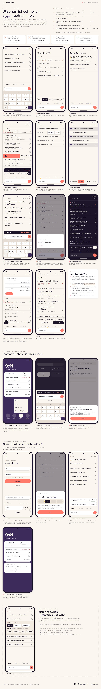

**Scores:** Efficiency 7.5 · Ease of use 6.5 · Brand fit 8 · Consistency with web 6.5 · Contract compliance 5 · Feasibility 6.5 · average 6.7

**Taps:** My count. T1: icon + Enter = 2; widget '+' + Enter = 2; tile: swipe + 2; share 3. In-app on Nächste: field + Enter = 2, and you stay on the tab with the chip kept (verified: judge/m4-capture-next.png, @business still selected, Inbox 6 with a yellow dot). T2: 1 swipe or 1 ring (trailing) (+1 undo); five at once: hold + 4 + Abhaken = 6. T3: pinned 'Nächste' shortcut = 1, else icon + tab = 2 (chip remembered). T4: shortcut 1, else 2. T5: icon = 1, then per item swipe 1, delete 2 (swipe left + Löschen); junk batch of five 6 taps with one undo.

**Effort:** 30-36 (+3 quick clarify) pd

**Strengths**

- Best in-app capture behaviour: it keeps the tab and the chip, says 'In Inbox ✓ · <text>' and puts a yellow dot on the Inbox count. Every other proposal should take this.
- The only proposal with batch actions (one notice, one undo), which matters for Inbox junk.
- Selection mode is fixed: its own plum marker, the ring inert and hidden from TalkBack, 'ausgewählt' state.
- Launcher shortcuts 'Nächste' and 'Warten auf' as pinnable icons give 1-tap T3/T4 without new surfaces.
- In-context teaching (a tip line after a ring tap, max three times) is the right way to teach gestures.

**Weaknesses**

- The core speed rests on invisible gestures, and the system back gesture owns both edges. The fix is still 'measure on the Pixel 9'.
- The swipe-left tray squeezes the description to about one word ('Rechnung…', frame 05), so you act on a row you can no longer read.
- 13 contract changes, the most of the five, including delete on Nächste/Warten auf and long press, which today does nothing.
- Rare-state strings drift: banner 'Zugang abgelaufen. Bitte neu einrichten.', setup heading 'Melde dich an', and a widget fallback text 'Die Übersicht konnte nicht geladen werden.' instead of today's 'Widget konnte nicht angezeigt werden'. These are not all pinned, but they contradict the board's own 'Was selten kommt, bleibt wörtlich'.
- The chip order puts 'Alle' last (contract order), while the web puts 'Alle' first: a small but daily inconsistency.

**Contract changes**

1. Tab row in the bottom stack; tabs hide while typing at >= 130 % font
2. Context chips in the bottom stack, persisted across restarts
3. Check ring at the right edge (Daumen links mirrors it)
4. Swipe left opens a row action tray
5. Long press selects; batch Abhaken/Löschen with one notice and one undo
6. Inbox row menu as a bottom sheet
7. Löschen on Nächste and Warten auf rows
8. Due next actions only under Fällig
9. Capture field on all three tabs; capturing keeps tab and chip
10. New launcher shortcuts 'Nächste' and 'Warten auf'
11. Mehr gains Auswählen, Gesten zeigen, Daumen links
12. Brand colours instead of dynamic colour
13. Banners move into the bottom stack

### 5. Daumenzone

`m1-daumenzone` · [mobile prototype](mobile/m1-daumenzone/index.html) · [README](mobile/m1-daumenzone/README.md)

Everything you tap is in one dock at the bottom, and every list is drawn in reach order: the newest capture and the most overdue row sit last, right above the dock.

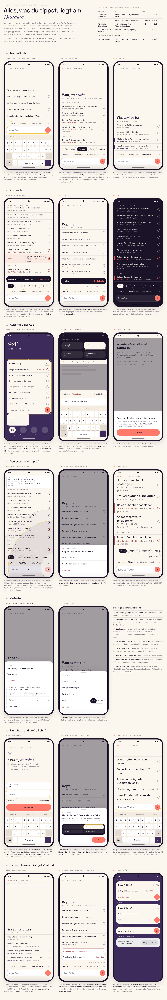

**Scores:** Efficiency 7.5 · Ease of use 6 · Brand fit 7.5 · Consistency with web 5.5 · Contract compliance 4.5 · Feasibility 6.5 · average 6.3

**Taps:** My count. T1: icon + Enter = 2; widget '+' (now bottom right) + Enter = 2; tile: swipe + 2; share 3; another tab: field + Enter = 2. T2: 1 (+1 undo). On Nächste the 4 most urgent rings are now in the easy band. In the Inbox with the keyboard up (how it opens) 4 of 5 rings are still stretch or hard, so effectively 2 taps (dismiss keyboard + ring). T3: icon + Nächste + chip = 3, or 2 with the optional remembered chip; widget 0. T4: icon + Warten auf = 2. T5: icon = 1 (+1 to drop the keyboard), then tick 1, delete 2, edit 2 + Enter.

**Effort:** 28-32 (+4-5 quick clarify) pd

**Strengths**

- The most rigorous reach work: a stated thumb model, proto.reach() measurements, and an honest correction of the round-1 claims.
- The notice is in the dock and takes space instead of covering the row under the thumb (pattern adopted by m3 and m5 too).
- Every rare state is designed in the dock (setup with fields at the bottom, banners, 'wartet auf Setup', widget states, pull without a spinner).
- Left-hand mode is thought through (ring, send, Rückgängig, chips mirror; text stays left-aligned).

**Weaknesses**

- Reach order inverts two pinned rules: 'newest first' in the Inbox and 'Fällig at the top' on Nächste. You read Nächste bottom-up, and TalkBack reads 'Nächste Aktionen' before 'Fällig'. It is the opposite of the web, where Fällig leads.
- Nächste still lists 'Belege Oktober hochladen' twice (in Nächste Aktionen and again in Fällig, board frame 01), the duplicate the other four removed.
- Short lists leave a huge empty band at the top (phone.png: about 60 % of the screen is blank above 'Kopf frei'), which reads as a broken layout.
- 11 contract changes, two of them to core reading order, which is the hardest set to get past the critic.
- The reach gain disappears exactly where the app opens (Inbox with the keyboard up).

**Contract changes**

1. Tabs at the bottom inside the dock
2. Check ring at the trailing edge
3. Inbox row menu as a bottom sheet
4. Mehr as a bottom sheet with 'Daumen links/rechts'
5. Widget '+' moves from the header to the bottom right
6. Details as a Partial Custom Tab (62 %)
7. Optional: remember the last context chip
8. Reach order on Nächste: Fällig becomes the last section (P08 'Fällig at the top' changes)
9. Reach order in Inbox and Warten auf: newest capture at the bottom (inventory 'newest first' changes)
10. Capture field on every tab
11. Undo notice in the dock column

## Mobile comparison

Scores 1-10 as given by the judge; the average is the mean of the six scores. Rows in ranking order. Effort in person-days (pd) before grafts.

| Proposal | Efficiency | Ease of use | Brand fit | Consistency with web | Contract compliance | Feasibility | Average | Taps | Effort (pd) |
|---|---:|---:|---:|---:|---:|---:|---:|---|---|
| Papier mobil (`m3-papier-mobil`) | 7 | 7.5 | 8.5 | 8.5 | 6.5 | 8 | 7.7 | My count from the home screen, warm. T1: icon + Enter = 2 (field already focused); widget '+' + Enter = 2; tile: swipe + 2; share: Teilen + runway + In Inbox = 3; on Nächste or Warten auf: field + Enter = 2 (today 3). T2: 1 (+1 to undo). The trailing ring is easy in the lower two thirds; top rows need a stretch or a swipe, which the README now admits. T3: icon + Nächste + chip = 3, or 2 with the remembered chip (CC4); widget glance = 0. T4: icon + Warten auf = 2. T5: icon = 1, then per item tick 1, delete 2, edit 3. | 16-20 (README says 14, which is too low for a bottom dock with IME handling, heading fold, banners and 9 contract negotiations) |
| Jetzt (`m2-jetzt`) | 8 | 7.5 | 8 | 7.5 | 5 | 7 | 7.2 | My count. T1: icon + Enter = 2; widget '+' + Enter = 2; tile: swipe + 2; share 3. T2: 1 (+1 undo). The rings are on the leading edge, which is a stretch for a right thumb; with the keyboard up (how Jetzt opens) they sit at y 160-415 dp. T3: icon = 1. This is the only proposal where 'what now in my context' is answered by opening the app; changing context costs +2 (chip in the heading, then the context). T4: the count and yellow dot are visible on open (1 for awareness), list = 2. T5: icon + Inbox tab = 2, then per item tick 1, delete 2, edit 2 + Enter. | 24-28 (+4 for the optional Kurz klären) |
| Überall (`m5-ueberall`) | 7.5 | 7 | 7.5 | 7.5 | 5.5 | 6.5 | 6.9 | My count. T1: widget capture bar + Enter = 2 (about 1.4 s with the 0.7 s overlay budget), the same tap count as m1's widget '+'; icon + Enter = 2; tile: swipe + 2; share 3; notification: swipe + expand + '+ Todo' + send = swipe + 3. T2: 1 (+1 undo), with the leading ring as on the web. T3: widget glance = 0, but only while on the home screen; in the app: icon + Nächste = 2 with the remembered chip. T4: pinned 'Warten auf' shortcut = 1, else 2. T5: icon = 1, then per row 1 (tick) or 2 (menu). | 30-35 (+4 quick clarify); 26-30 without the notification |
| Gesten (`m4-gesten`) | 7.5 | 6.5 | 8 | 6.5 | 5 | 6.5 | 6.7 | My count. T1: icon + Enter = 2; widget '+' + Enter = 2; tile: swipe + 2; share 3. In-app on Nächste: field + Enter = 2, and you stay on the tab with the chip kept (verified: judge/m4-capture-next.png, @business still selected, Inbox 6 with a yellow dot). T2: 1 swipe or 1 ring (trailing) (+1 undo); five at once: hold + 4 + Abhaken = 6. T3: pinned 'Nächste' shortcut = 1, else icon + tab = 2 (chip remembered). T4: shortcut 1, else 2. T5: icon = 1, then per item swipe 1, delete 2 (swipe left + Löschen); junk batch of five 6 taps with one undo. | 30-36 (+3 quick clarify) |
| Daumenzone (`m1-daumenzone`) | 7.5 | 6 | 7.5 | 5.5 | 4.5 | 6.5 | 6.3 | My count. T1: icon + Enter = 2; widget '+' (now bottom right) + Enter = 2; tile: swipe + 2; share 3; another tab: field + Enter = 2. T2: 1 (+1 undo). On Nächste the 4 most urgent rings are now in the easy band. In the Inbox with the keyboard up (how it opens) 4 of 5 rings are still stretch or hard, so effectively 2 taps (dismiss keyboard + ring). T3: icon + Nächste + chip = 3, or 2 with the optional remembered chip; widget 0. T4: icon + Warten auf = 2. T5: icon = 1 (+1 to drop the keyboard), then tick 1, delete 2, edit 2 + Enter. | 28-32 (+4-5 quick clarify) |

## Mobile recommendation

Build m3 Papier mobil as the Android base and graft four things onto it: m2's 'Jetzt' answer, m4's capture behaviour, m5's widget capture bar, and a flat, non-3D version of 06's lens. With that, Android and the web combination become one product rather than two siblings.

Why m3. Tap counts barely differ across the five. I counted T1 = 2, T2 = 1 + 1 and T4 = 2 for every proposal from the app icon, and every proposal reaches T3 = 0 on the widget. So the decision rests on reach, calm, contract cost and how closely the phone matches the web. m3 is the only proposal that is at the same time:
- the web's own page, with the same row, eyebrows, notice and strike;
- careful about space: the notice sits in the layout flow, the field is on every tab, Fällig shows once, and the heading folds with the IME, on scroll and at large font;
- the cheapest and lowest-risk option: no new surfaces, no gesture system, and 9 contract changes that are mostly positional.

Its gap is that it has no answer to 'what now' beyond a flat list, and m2 has the best one. On scores it sits at about 7.5 overall, ahead of m2 (about 7.1).

How it pairs with 06. Strong once three mismatches are fixed:
- Nächste must use 06's sections (Fällig · Jetzt · Bald · Später). None of the five mobile proposals does, so today the most-used screen is ordered differently on phone and web.
- The tally must go. 06 replaced it with the lens, so the phone should show the lens's 2D form (the 14 px ring and the Glance vector levels from 01) with '3 von 7 heute'. No 3D: it is the same number in the same place.
- Phone web (06 at 412 px) should adopt the same bottom dock. My shot judge/06-phone-undo.png shows 06's phone layout still has top tabs and a floating notice that covers a row ('Hosting-Vertrag prüfen' and its ring), which is exactly what the mobile proposals fixed.

The context sets also differ:
- web: @computer @anrufe @zuhause @unterwegs @buero, plus 'ohne Kontext';
- Android preset: @home @computer @work @business.

Every board hides this by mapping demo data. That is round-1 open question 12 and it now blocks consistency.

Ring side is the one deliberate split. Trailing on Android (thumb) against leading on the web (reading order) is defensible, because swipe right is the shared gesture, but Uli should confirm it.

Effort for m3 plus the grafts: 22-28 pd on Android, on top of the shared token and rules foundation.

## Mobile grafts

- From m2 Jetzt: the 'Jetzt' answer, but not as a fourth tab or a new start screen (that breaks the frozen done-bar U2). Nächste opens with Fällig, then 06's Jetzt section (overdue, due today, running, prio H, für heute) in the remembered context, then Bald and Später collapsed under 'N weitere'. This gives T3 = 2 taps (icon + Nächste) with no contract change beyond m3's, and the same section words as the web. +1.5-2.5 pd.
- From m2 Jetzt: the widget shows Fällig + Jetzt of its chip context (the same model as the app), with '+K weitere' hidden at 0. +0.5-1 pd.
- From m4 Gesten: capture from Nächste or Warten auf keeps the tab and the chip, the notice reads 'In Inbox ✓ · <text> · Rückgängig', and the Inbox tab count gets a yellow dot until visited (verified working in judge/m4-capture-next.png). +0.5-1 pd.
- From m4 Gesten: dynamic, pinnable launcher shortcuts 'Nächste' and 'Warten auf' next to the pinned 'Neues Todo' and 'Inbox', for 1-tap T3/T4 from the home screen. +0.5 pd.
- From m4 Gesten: the Inbox row menu as a bottom sheet in thumb reach (same items, one tap), replacing m3's dropdown that covers the row text. m1 and m5 do the same. +0.5 pd.
- From m5 Überall: the widget capture bar as the first row ('Neues Todo' + coral '+', contentDescription '+ Todo'), replacing the small header '+'. +1-1.5 pd.
- From m5 Überall: draw the QS tile, shade and launcher popup in system colours on the board and in the spec. Fix m3's coral QS tile, which Android cannot render.
- From 06-kombination: replace m3's tally with the lens's flat form (the 2D ring with liquid level from 01's Glance vector levels, plus '3 von 7 heute' and '· N zusätzlich'), and the same 't' / 'für heute' rule. No shader, no 3D. +1-2 pd.
- From 05/06 rule set: if Uli lifts the clarify non-goal, use m4's quick clarify (Nächste always asks for a context; Warten auf asks for the follow-up day). Drop m3's bare 'Nächste' chip, which guesses metadata. +3-4 pd, optional.
- From m1 Daumenzone: an in-place confirm for 'Altes Konto … Verwerfen' and the pull-to-refresh as a 1 px yellow line plus mono text (no spinner), both already close to m3's.

## Open questions for Uli (mobile)

1. Ring side on Android: trailing (thumb reach, as in m3/m4/m1) while the web keeps it leading, or leading on both (as in m2/m5) for one muscle memory? Swipe right works on both either way.
2. Tabs and context chips at the bottom on Android: all five proposals move them, against the pinned top position. Approve the bottom dock, and should phone web (06 at 412 px) follow it?
3. 'What now': keep Inbox as the start screen and make Nächste open with Fällig + Jetzt (recommended), or approve m2's separate Jetzt start screen and fourth tab, which needs you to re-freeze done-bar.md?
4. One context list for both clients: today the web uses @computer @anrufe @zuhause @unterwegs @buero, and Android uses @home @computer @work @business. Which set, and should it become a shared, editable preference (small backend endpoint)?
5. Clarify on the phone: every board shows a quick-clarify option. Lift the 24.10.2026 non-goal (2 taps per item, context always asked, +3-4 pd), or keep the phone capture-and-glance only?
6. Widget: replace the header '+' with a full capture bar as the first row, and show Fällig + Jetzt of its chip?
7. Show the day's lens on the phone as a flat 2D ring with '3 von 7 heute' (no 3D), or no progress indicator on the phone at all?
8. Optional 'Nächste' notification (sits under Lautlos, dismissable since Android 14): build it (about 4 pd) or skip?
9. Launcher shortcuts 'Nächste' and 'Warten auf' as pinnable home-screen icons: yes?
10. Remember the context chip across restarts: until midnight, or until you change it?
11. Batch select (long press, one undo for many) for Inbox junk: worth about 3 pd now, or later?

---

## Round 1

The first round, unchanged: five unified designs for web and Android, ordered by the judge's ranking.

### Ranking

1. [Papier & Tinte](#1-papier--tinte) (`03-papier-und-tinte`), average 7.4
2. [Warmes Glas](#2-warmes-glas) (`01-warmes-glas`), average 7.1
3. [Greifbar](#3-greifbar) (`05-greifbar`), average 6.7
4. [Orbit](#4-orbit) (`04-orbit`), average 6
5. [Startbahn](#5-startbahn) (`02-startbahn`), average 6

### 1. Papier & Tinte

`03-papier-und-tinte` · [web prototype](03-papier-und-tinte/index.html) · [Android prototype](03-papier-und-tinte/android.html) · [README](03-papier-und-tinte/README.md)

An editorial page in place of an app chrome: typography, hairlines and a margin column carry all the structure. A coral pen stroke marks done, a tally shows today's work, and one Three.js ink bloom plays only when the Inbox goes to zero.

| Web · desktop | Android | Signature moment |
|---|---|---|
| 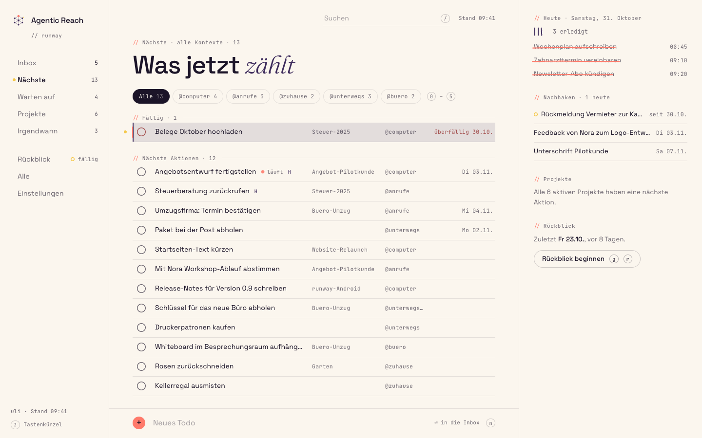 | 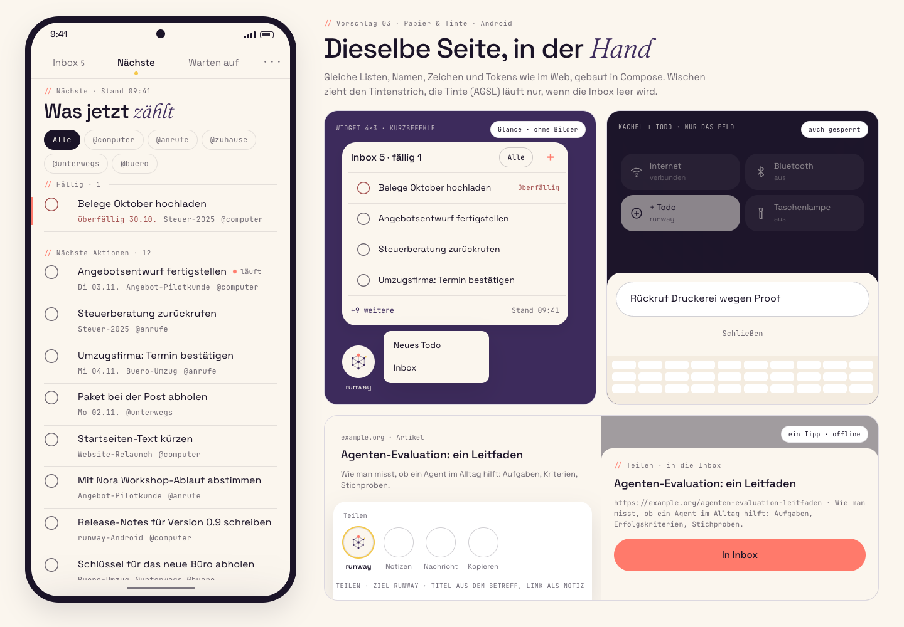 | 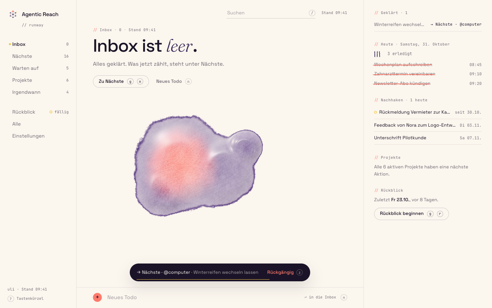 |

**Strengths**

- The densest and fastest of the five. Desktop rows are one line with mono meta in fixed columns. Inbox triage takes two keys (a + digit), `0`-`5` filter contexts on Nächste, and the docked clarify panel at 761-1180 px means a key never acts unseen. This is the only proposal that reaches Linear-level keyboard work.
- The margin column (Heute struck through with times, Nachhaken, stalled projects, Rückblick) answers 'what's going on' without a 3D object. It is the best overview use of space in any proposal.
- The pinned Android states are actually designed: Inbox with the keyboard up (six 56 dp rows), the outbox row states, the failed-row menu, both banners, and 150 % text (android-zustaende.png). No other proposal shows these.
- The list semantics are the only ones verified against the real API. rules.js sends tags_add/tags_remove with an exact inverse for undo, and 9 tests pass. It is the best source for the shared rules module whichever look wins.
- Closest to the kit: Agentic Reach lockup, a single Fraunces accent word per heading, no glass. Lowest effort and lowest risk.

**Weaknesses**

- It does not deliver the 'fancy, very cool, three.js' part of Uli's request. The one WebGL moment is rare: it shows at most once per inbox-zero, for 3.4 s. Mid-bloom (web-signature.png) it reads as a purple-and-coral stain on the page rather than as delight.
- At a glance it can look like a well-typeset spreadsheet. Without the effect it relies entirely on type, and the phone screens are calm to the point of plain.
- The 'Was jetzt zählt' display headings cost about 120 px on phone web before the first row, and the heading is never collapsed on Nächste.
- The Android → web detail handoff needs two new security-relevant auth endpoints, or a login in the Custom Tab.
- Android tab weights of 1:1:1.3 and a '···' Mehr item with only a content description need the acceptance critic's consent.

**Brand deviations**

- Ink text on coral pills (7.0:1 instead of 2.5:1)
- Coral as the overdue/error signal (Android contract requires overdue to be measurably red)
- Coral as 'done' ink (strike, every fifth tally stroke)
- Plum-light (plum mixed into off-white) as accent on dark
- Watercolour gradients during the 3.4 s ink bloom
- Fraunces italic beyond the single accent word (project outcomes, plan vision)
- Mixed-case mono eyebrows (Android pins literal strings)
- Pill keycaps as a recurring hint element
- System glyphs for QS tile, notification and themed launcher icon
- Possible system-font fallback in the Glance widget
- German only, strings in message tables instead of data-i18n

**Best for:** The base of the real build: the IA, row anatomy, keyboard model, list rules, Android states and token pipeline, with a richer signature effect grafted on top.

### 2. Warmes Glas

`01-warmes-glas` · [web prototype](01-warmes-glas/index.html) · [Android prototype](01-warmes-glas/android.html) · [README](01-warmes-glas/README.md)

Paper cards on warm ground plus one data-carrying glass object, the Tageslinse. Its coral liquid level is today's planned progress ('4 von 7'), and each completed todo flies into it as a bead along a coral thread.

| Web · desktop | Android | Signature moment |
|---|---|---|
| 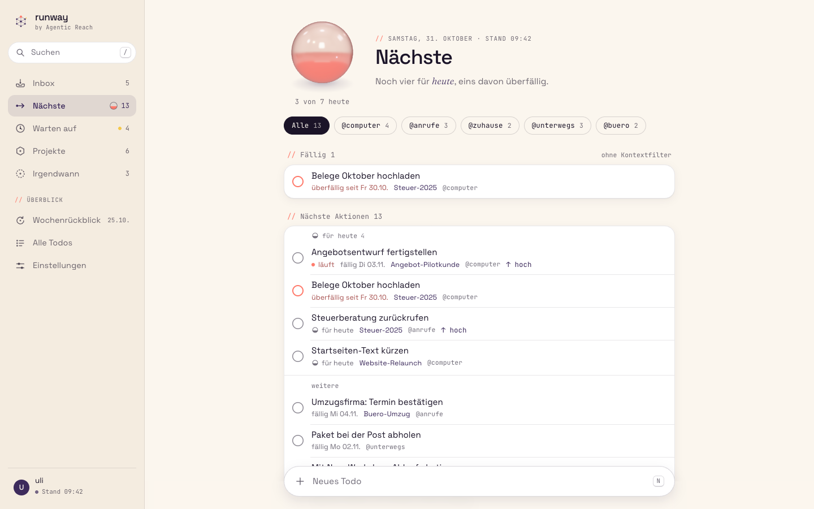 | 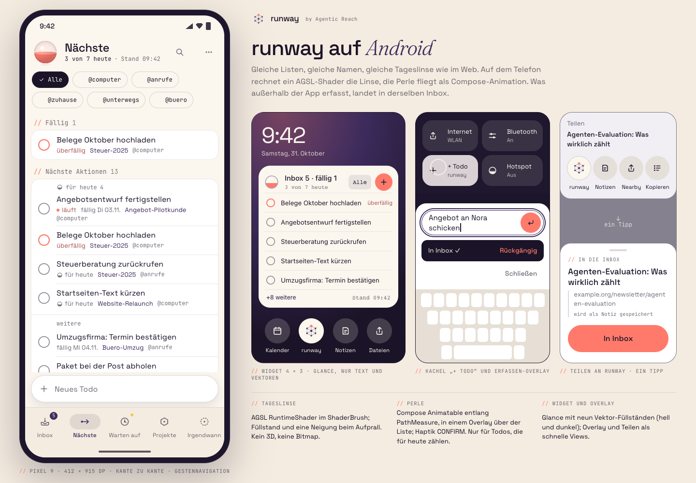 | 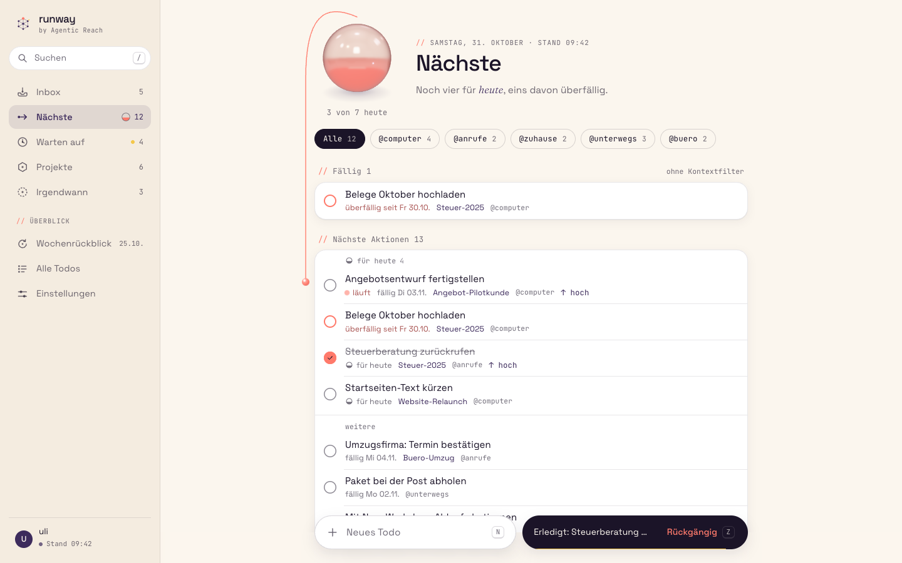 |

**Strengths**

- The only 3D object across the five that carries a persistent, glanceable number. With the stable 'planned only' rule, completing a planned todo now goes 3 → 4 von 7 (verified with proto.signature()), and unplanned completions show as '· 1 zusätzlich'. The same lens appears as a 14 px sidebar ring, the Android top-bar AGSL lens and nine Glance vector levels, which makes it the strongest cross-platform signature.
- Very consistent between web and Android: same five lists, same row anatomy, a bottom nav on phone web and on Android, and the same captions.
- The Android Inbox keeps a text tab row (Inbox · Nächste · Warten auf) while the keyboard is up. This fixes the first-round P08 failure and is a pattern worth keeping in any build.
- The phone web Klären sheet (one tap applies, context chips unfold) is clean and touch-correct.
- Disciplined effects budget: 0 frames idle, 53 frames per completion, SVG fallback with the same information.

**Weaknesses**

- Nächste shows 'Belege Oktober hochladen' twice in the first viewport ('Fällig' and again in 'Nächste Aktionen'), and the 'für heute / weitere' sub-grouping adds a third structural layer. It wastes rows and reads as a bug.
- The Inbox pebbles look like grey lumps or dumplings in light mode (web-inbox.png). On Android they are hidden whenever the keyboard is up, which is almost always. They add nothing over the count.
- Cards inside cards (a section card containing rows with their own separators) are heavier than Things. Desktop rows are two-line and less dense than 03.
- The lens needs a 'for today' planning habit (T / scheduled) that Uli may not have. Without it the denominator is just the overdue items.
- The AGSL shader has never been compiled on a device. Transmission glass varies by GPU, and Safari needs a quality step-down.

**Brand deviations**

- Own glyph set (26 glyphs from the mark's vocabulary)
- Glass in one place (Tageslinse, pebbles), against the kit's no-glassmorphism rule
- Coral beyond the primary action as a closed list (check ring, overdue ring, lens liquid, bead, Rückgängig)
- Derived color-mix shades (action-ink, plum-light, structure-select)
- Ink text on coral buttons
- Dark as an app-wide theme instead of dark sections
- Shading gradients inside depicted 3D objects and their SVG fallbacks
- System fonts in the Glance widget
- Product lockup 'runway by Agentic Reach' instead of mark + Agentic Reach
- Mixed-case mono section headings
- German-only message files instead of data-i18n

**Best for:** Its Tageslinse is the best single 3D graft: one persistent, meaningful, cheap-at-idle object that works on web, Android and the widget.

### 3. Greifbar

`05-greifbar` · [web prototype](05-greifbar/index.html) · [Android prototype](05-greifbar/android.html) · [README](05-greifbar/README.md)

A desk of tangible things: you clarify the Inbox by picking the top card off a stack and dropping it into GTD trays, which turn into the follow-up answers when one is needed. You tick a todo off with a clay pill that squishes, and a toy version of the mark lights up as today's Inbox clears.

| Web · desktop | Android | Signature moment |
|---|---|---|
| 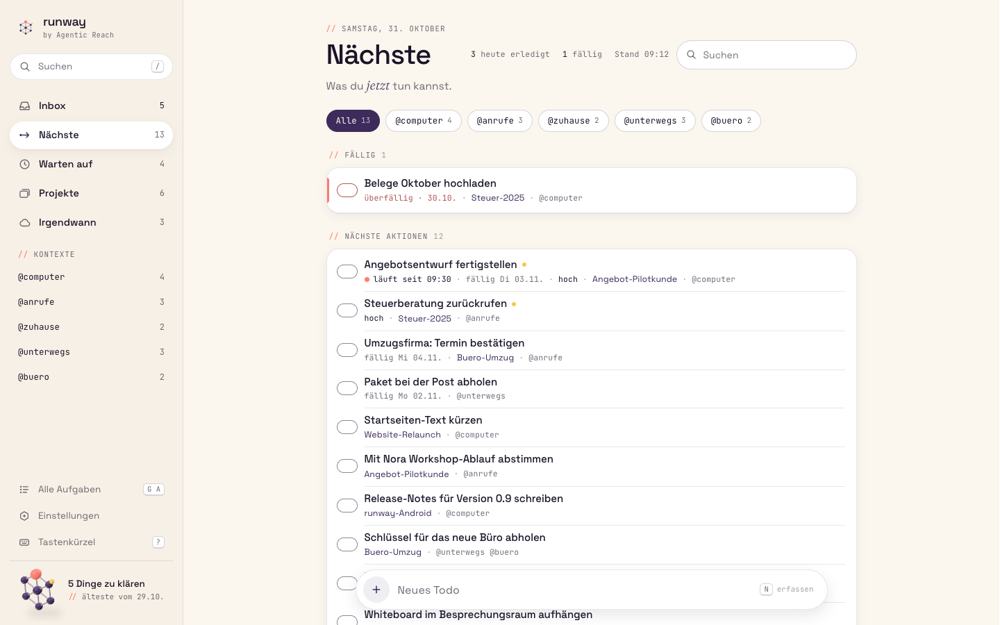 | 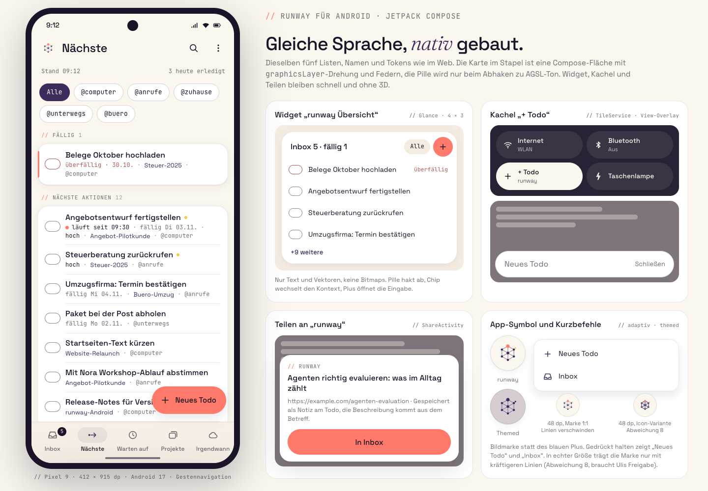 | 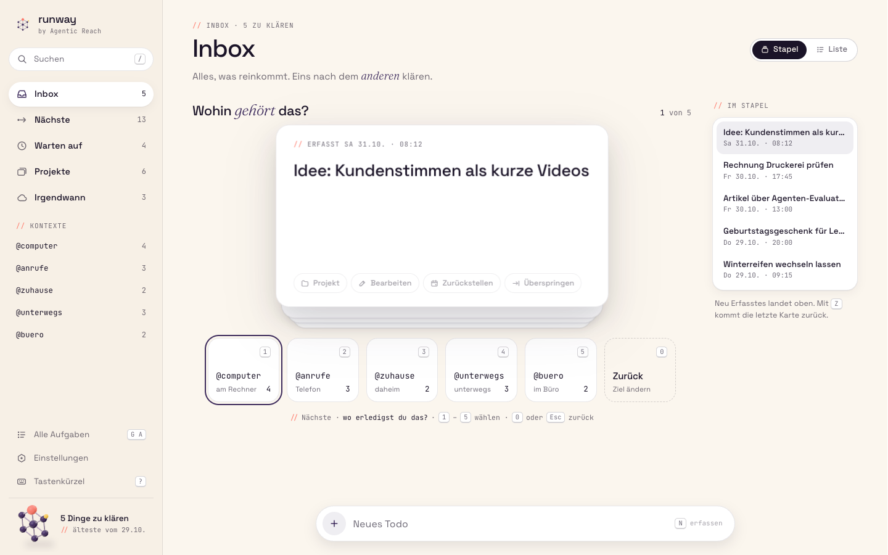 |

**Strengths**

- The card-stack Klären is the most engaging Inbox processing of the five. The step state is now fixed: the card stays full size, the next card is hidden, every context gets a tray, and there is a 'Zurück' tray plus Esc and Android Back (checked at phone width: 05-phone-step.png). Keys 1-5 / 1-9 make it fast on desktop too.
- 'Never guess metadata': every route into Nächste asks for a context and the store refuses Nächste without one. Warten auf asks for a follow-up day. This is a rule the real app should adopt whatever the look.
- Sensible use of tech after review: the card is DOM with CSS 3D (sharp text), and Three.js is used only for the pill squish and the companion, scissored and at 0 frames idle.
- A clean, airy Nächste list with a Stapel/Liste toggle. Phone web mirrors Android (bottom nav, newest-first Inbox, 'Klären · 5').
- The companion (the mark as a lit toy) has real brand charm and ties into the approved figure direction.

**Weaknesses**

- The empty pill as the check control reads as a toggle switch or a blank input, not 'tick off'. That is a worse affordance than a ring for the most frequent action, and it breaks the Android ring contract.
- The companion modifies the sacred mark, which is a brand-governance risk. On desktop it sits in the sidebar foot where it is rarely looked at.
- The tactile magic is concentrated in Inbox processing. Nächste, Warten auf and Projekte are a competent but generic list (web-desktop.png looks like any 2024 todo app).
- The highest total effort of the realistic options (58 pd, 72.5 with contingency). Phase 2 depends on three Android non-goals being lifted.
- preserve-3d and perspective on the card were checked only in Chromium.

**Brand deviations**

- Own icon set (28 glyphs)
- 3D companion derived from the mark (character, not logo)
- Product lockup 'runway by Agentic Reach', shortened on phones
- Coral for urgency (overdue bar, pill outline, mixed text)
- Ink text on coral buttons
- Light-on-material gradients (clay sheen, rim light, halos)
- Contact shadows in 3D outside the four shadow tokens
- Launcher icon variant with thicker mark lines

**Best for:** Its card stack is the best graft for Inbox processing on touch (phone web and Android Klären) and as an optional 'Stapel' mode on desktop.

### 4. Orbit

`04-orbit` · [web prototype](04-orbit/index.html) · [Android prototype](04-orbit/android.html) · [README](04-orbit/README.md)

A 3D clay disc beside the list: each context is a sector, three urgency rings sit around you at the centre, glazed beads are next actions and clay beads in a tray are the inbox, and a completed bead flies into the hub.

| Web · desktop | Android | Signature moment |
|---|---|---|
| 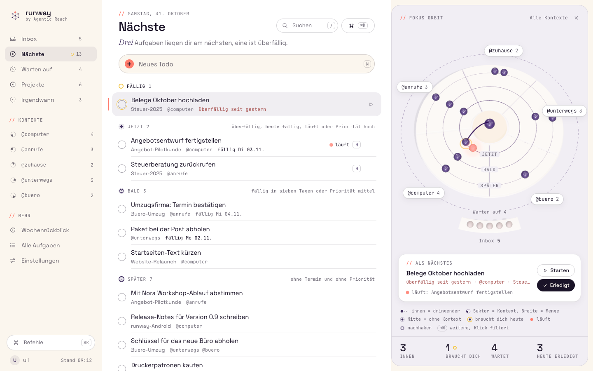 | 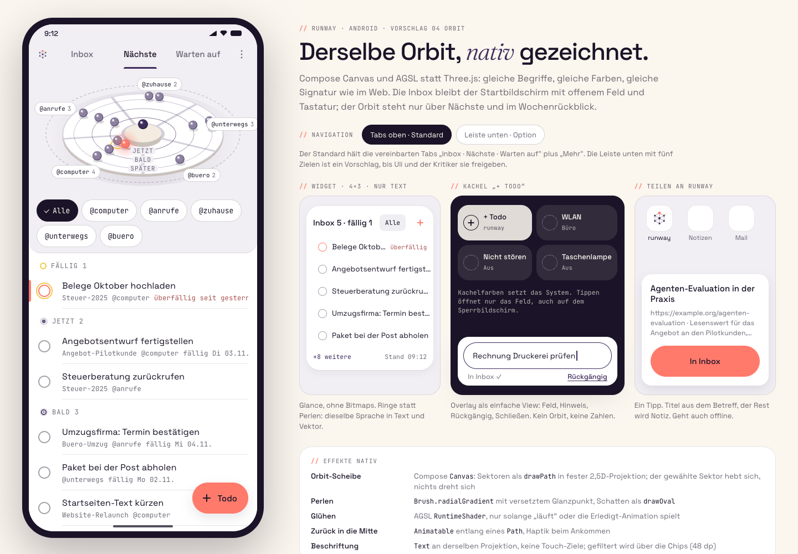 | 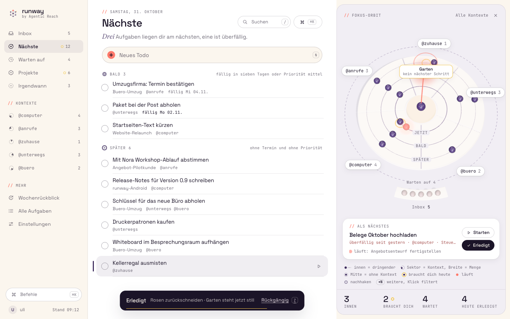 |

**Strengths**

- The most striking still image at demo volume, with a well-lit clay disc and a good dark 'Plum-Nacht' variant.
- The ring rule (Jetzt / Bald / Später from due, start and priority, not from Taskwarrior's score) is a real improvement. Used as list sections it makes Nächste easier to scan even without the orbit.
- 'Ohne Kontext' gets its own hub slot and filter, and '+N' beads filter the list to a sector and ring. This handling of edge cases is thoughtful.
- A ⌘K command palette and the most complete inventory coverage on the web.

**Weaknesses**

- The orbit needs a nine-item legend (web-desktop.png). An object that needs a legend is not glanceable.
- At Uli's real volume (`?volume=real`, 04-real.png): @computer takes half the disc with +11/+2/+1 beads, @home's beads stack into a column, three sectors are empty, and the inbox tray shows '+16'. The answer it gives is 'most things are @computer and later', which the sidebar counts already say.
- It permanently costs about 480 px of desktop width and 184 px of phone height on the most-used screen, for information that is duplicated in the list.
- The most expensive and riskiest Android build: a full client with Klären, a detail sheet, a review pager and a 2.5D Canvas orbit, all of it against non-goals.
- Every todo appears in two places (bead and row), with hover linking between them: two focal points on the main screen.

**Brand deviations**

- Custom icon set (22 glyphs)
- Gradients inside 3D shading (bead highlights, running halo)
- Coral beyond the main action (läuft, overdue bar, derived overdue text)
- Ink text on coral buttons
- Yellow with a fixed meaning (ring = braucht dich heute)
- Product lockup 'runway by Agentic Reach'
- Plum-Nacht surfaces as ink/plum mixes
- 6 px blur behind the command palette
- German only for now, i18n keys later

**Best for:** A source of ideas (ring-based sections, ohne-Kontext handling, ⌘K palette), not the base to build.

### 5. Startbahn

`02-startbahn` · [web prototype](02-startbahn/index.html) · [Android prototype](02-startbahn/android.html) · [README](02-startbahn/README.md)

Nächste as an airfield: the top three next actions in the active context wait 'cleared' at the runway threshold in three urgency tiers, a completed one lifts off on a coral trail, waiting items circle in a holding pattern, and inbox pucks sit on the apron.

| Web · desktop | Android | Signature moment |
|---|---|---|
| 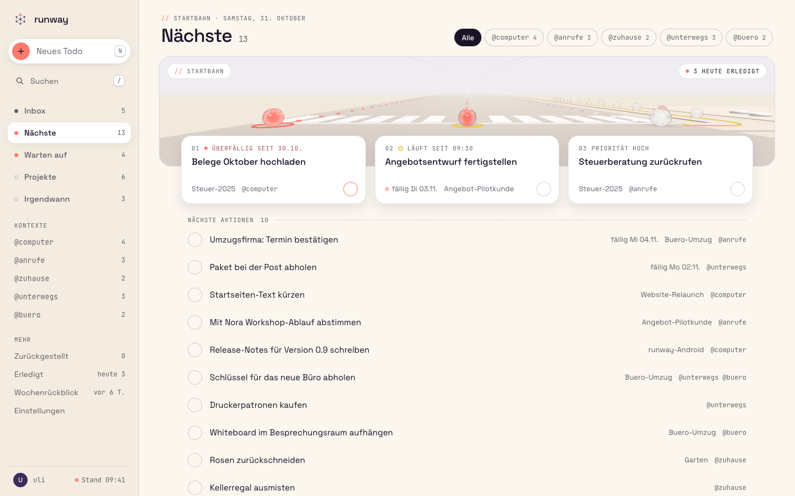 | 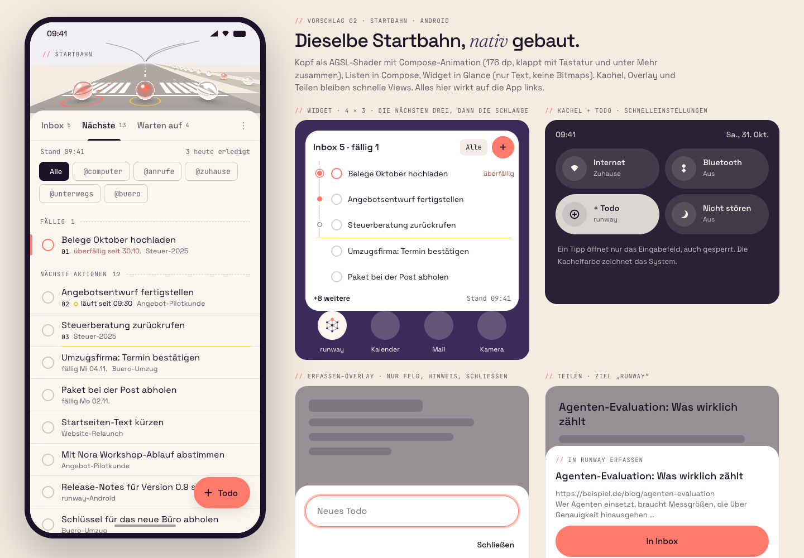 | 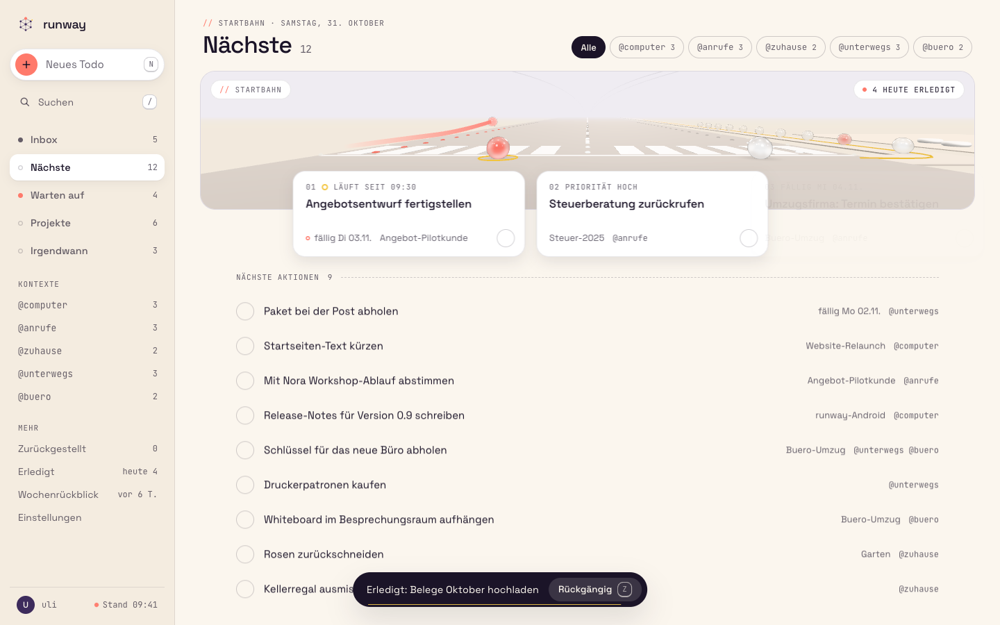 |

**Strengths**

- The three 'cleared' cards (01 überfällig, 02 läuft, 03 Priorität hoch) are a good 'do this now' focus device. The context filter is now correct: with @anrufe, slot 01 is an @anrufe task and the overdue @computer item drops to 'Fällig · andere Kontexte' (02-anrufe.png).
- The Inbox clarify card with numbered outcome buttons (1 Nächste, 2 Warten auf, 3 Irgendwann, 4 Projekt, X, ⌫) is fast and clear.
- The strongest web data-safety story: captures sent at once, other writes held, mirrored to IndexedDB and flushed with keepalive, plus a visible 'Nicht gesendet · Erneut senden'.
- The only proposal with real data-i18n (DE default, EN second), as the kit asks.

**Weaknesses**

- The field still mostly repeats the DOM. In the filtered view all three spheres are identical paper beads, and in light mode the 'tiers' are hard to tell apart at 200 px. The cards overlap the field's lower half, so it looks like a busy banner.
- The aviation metaphor sits furthest from the Agentic Reach voice (eyebrows: vorfeld, warteschleife, hangar). It is a gimmick that ages badly in a tool used many times a day.
- The inbox 'pucks' look like white cookies (web-inbox.png), and the selected puck's ink ellipse looks like a stray scribble.
- The heaviest effects stack: a 600-line physical scene, bloom in dark mode, FLIP sync between 3D and DOM, and an 8-day AGSL ray-cast header on Android. That is the highest risk for the lowest information gain.
- The Android header takes 176 dp on Nächste and Warten auf.

**Brand deviations**

- Glass and light (transmission, emissive, bloom) in the field
- Shading, fog and halo gradients in the field
- Coral beyond the primary action as a long closed list (urgency, feedback, focus halo, swipe tint)
- Ink text on coral buttons
- Four in-house glyphs
- Product lockup mark + 'runway'
- Fixed app type sizes instead of display clamps
- Kit components adapted (3 px hover lift, .ar-frame at radius 22)

**Best for:** Its outbox and i18n engineering and the 'Fällig · andere Kontexte' filter rule; not the visual direction.

### Comparison

Scores 1-10; the average is the mean of the seven scores. Rows in ranking order. Effort in person-days (pd) before grafts.

| Proposal | Usability | Appeal | Brand fit | Three.js value | Web feasibility | Android feasibility | Cross-platform unity | Average | Effort web (pd) | Effort Android (pd) |
|---|---:|---:|---:|---:|---:|---:|---:|---:|---:|---:|
| Papier & Tinte (`03-papier-und-tinte`) | 8 | 7 | 8.5 | 3.5 | 8.5 | 7.5 | 8.5 | 7.4 | 30-36 | 26-32 |
| Warmes Glas (`01-warmes-glas`) | 7 | 7.5 | 7.5 | 5.5 | 7 | 6.5 | 8.5 | 7.1 | 42-50 | 30-38 |
| Greifbar (`05-greifbar`) | 7 | 7.5 | 7 | 5 | 7 | 6 | 7.5 | 6.7 | 34-40 | 30-36 |
| Orbit (`04-orbit`) | 6 | 7 | 7 | 4.5 | 6 | 5 | 6.5 | 6 | 45-55 | 40-48 |
| Startbahn (`02-startbahn`) | 6.5 | 6.5 | 6 | 4 | 6.5 | 5.5 | 7 | 6 | 46-55 | 33-42 |

### Recommendation

Build 03 Papier & Tinte as the base and give it a real signature effect by grafting 01's Tageslinse and 05's card stack onto it. The result is about 'Papier & Tinte with one piece of glass and a stack of cards'.

**Why.** 03 is the only proposal where the parts Uli uses many times a day (Nächste, the Inbox with the keyboard up, triage, Warten auf, the outbox states) are designed to Things/Linear level on both platforms. It also has the only API-verified list rules (tags_add/tags_remove with an exact inverse, tested), is closest to the brand kit, and costs the least (web about 30-36 pd, Android about 26-32 pd before grafts). Its one real gap is the request itself: 'fancy, very cool, three.js'. Its only 3D moment shows at most once a day and looks like a stain mid-bloom. 01 and 05 each fill that gap with an effect that carries meaning, which 02 and 04 do not: at real volume their 3D centrepieces repeat what the list already says, need legends, and take the most valuable space.

**Concretely.** Keep 03's shell (rail + page column + margin column, phone tabs), row anatomy, headings and keymap. Replace the margin's tally count with the Tageslinse as the persistent 3D object in the Nächste header and in the margin (web Three.js, Android AGSL, Glance vector levels). Keep the struck-through 'Heute' list beneath it. Add the card stack as the touch Klären mode and as an optional 'Stapel' view on desktop. Keep the ink bloom only if budget remains; it is the first thing to cut.

Total effort with grafts: web 38-46 pd, Android 32-40 pd, plus 1 backend day if the handoff endpoints are approved. Scores are on one scale (5 = average app, 8 = Things 3 / Linear). No proposal reaches 8 overall: 03 gets there on usability and unity, but none gets there on effects value.

### Grafts

| From | Element | Why |
|---|---|---|
| [Warmes Glas](01-warmes-glas/README.md) | The Tageslinse: a glass lens whose liquid level is planned progress today. It uses the stable rule from dayProgress.js (total = due ≤ today + scheduled ≤ today + started, plus planned-and-done; unplanned completions shown as '· 1 zusätzlich'). Bead flight only for planned todos, the 14 px sidebar ring, the Android top-bar AGSL version (android/tageslinse.agsl) and the nine Glance vector levels. | It is the only 3D object across the five that carries a persistent number worth glancing at. It costs 0 frames idle, and it gives 03 the 'cool' Uli asked for without touching its density. The lens replaces 03's tally count; 03's struck-through 'Heute' list stays. |
| [Greifbar](05-greifbar/README.md) | The Inbox card stack (stack.js/card.js): DOM card with CSS 3D springs, five trays with keys 1-5, trays turning into the answers (contexts 1-9, follow-up days, Zurück/Esc/Back), the Stapel/Liste toggle, and 'Klären · N' on phone web and Android. | It is the best touch clarify flow. 03's two-key panel stays the default on desktop, and the stack becomes the touch mode and an optional desktop mode. Both drive the same rules.js moves. |
| [Greifbar](05-greifbar/README.md) | The 'never guess metadata' rule: every route into Nächste requires a context (the store refuses Nächste without one), and Warten auf asks for a follow-up day (morgen · Freitag · nächste Woche · ohne Datum) that writes scheduled. | It fixes a silent data-quality bug class (the original web tagged @computer by default) and makes the Nachhaken sections work. |
| [Warmes Glas](01-warmes-glas/README.md) | The Android IME rule: while the keyboard is up, the top bar is a 48 dp text tab row Inbox · Nächste · Warten auf, so another list is one tap away; the draft is kept on scroll or Back. | It keeps P08 §1 satisfied whatever navigation Uli picks. |
| [Orbit](04-orbit/README.md) | The ring rule as list sections in Nächste: after Fällig, group into Jetzt (overdue, due today, running, prio H) · Bald (due ≤ 7 days, prio M) · Später, computed from fields Uli sets, not the urgency score. Plus the 'ohne Kontext' filter chip. | It makes the long Nächste list scannable at Uli's real volume (39 next actions) with no 3D needed, and it removes the misleading scheduled-date urgency bonus. |
| [Orbit](04-orbit/README.md) | The ⌘K command palette (actions + navigation + search). | 03 left it out deliberately. It is the one Linear feature missing for a keyboard-first desktop user, and it costs about 2 pd. |
| [Startbahn](02-startbahn/README.md) | The web write path: captures POSTed at once (undo = DELETE); other writes held 6 s, mirrored to IndexedDB and flushed with keepalive on pagehide/visibilitychange; visible 'Nicht gesendet · Erneut senden' on the row and in the footer. | It is the most concrete no-data-loss design for the web client and pairs with 03's inverse-tag undo. |
| [Startbahn](02-startbahn/README.md) | The context filter rule: due items from other contexts stay visible in an unranked 'Fällig · andere Kontexte' section when a context is active. | Overdue work never disappears behind a filter, and the main list stays honest about context. |
| [Startbahn](02-startbahn/README.md) | The i18n structure (every string a key, German default), even if v1 ships German only. | It costs almost nothing now and avoids touching every component later; it also answers the kit's data-i18n rule. |

### Common foundation

- **Token pipeline:** one tokens.json (brand primitives copied from shared/brand/tokens.css plus semantic tokens: bg, sheet, ink, text, mute, line, plum-light, action-ink = coral 62 % + ink for small coral text, overdue, done, focus, light and dark values). A generator writes tokens.css, a Tailwind theme mapping and RunwayTokens.kt (resolved sRGB for Compose). CI checks the hash of the generated files against tokens.json. Ink text on coral buttons everywhere. JetBrains Mono 400 only. Fonts bundled locally (woff2 on web, res/font on Android). Dynamic colour off on Android.
- **Shared rules module:** one pure GTD rule set (lists from the server definition with +next required; Inbox = no tags and no project; lenient context rule on Nächste and the widget; Fällig never filtered; list moves as tags_add/tags_remove with exact inverses for undo; 6 s hold for complete/delete with Rückgängig; outbox semantics). Written once in TypeScript (frontend/src/shared) and once in Kotlin, both run against the same JSON test vectors (start from 03's rules.test.mjs).
- **Component inventory (same names on both clients):** AppShell (web rail + optional margin column; phone tabs), PageHeader (mono eyebrow with 'Stand hh:mm' + heading + one Fraunces accent word), SectionHeader ('// Fällig · 1'), TaskRow (check ring, title, mono meta, overdue edge rule, läuft pulse dot, outbox status line, swipe on Android), ContextChips (wrap, never scroll), CaptureBar (N on web; bottom field on Android; never asks for metadata), UndoNotice with the 1 px yellow time line, ClarifyPanel / ClarifySheet / CardStack (same outcomes and keys), DetailPanel/Sheet, ProjectRow with the 'steht still' state and inline next-action field, ReviewSteps, EmptyState, ErrorRow and Banner, CommandPalette (web), and the Android-only Widget, TileOverlay, ShareCard and LauncherIcon.
- **Effects policy (rule 5.1 made binding):** every effect explains state or gives feedback, or it is cut. At most one WebGL canvas per screen, imported lazily after first paint, rendering only while something changes (target 0 frames idle, measured in CI with proto.frames-style counters), paused when hidden. Context loss, no WebGL and prefers-reduced-motion all fall back to a static SVG with the same information. No text in WebGL. NeutralToneMapping, clamp before pow(), no full-screen bloom on light themes. Android uses AGSL RuntimeShader / Compose Canvas only (no Filament, no bitmaps in Glance), and the shader composable exists only while visible. Budgets: first paint never waits for Three.js, and Android cold start for the tile overlay stays within its 700 ms budget.
- **Android mapping:** Compose theme generated from tokens. Navigation is the pinned three text tabs + Mehr unless Uli approves a bottom nav; either way there is a text tab row while the IME is up. Rows map 1:1 to TaskRow with swipe-to-complete and haptics. The Glance widget uses text + vector drawables. The tile and overlay are plain Views with only field, notice, Rückgängig and Schließen. The share card is one tap to 'In Inbox'. Details open in a Custom Tab on the web route ?task=<uuid> (native sheet only if the non-goal is lifted). All writes go through the existing outbox, and the acceptance-test string pins (Fällig, Stand hh:mm, Nachhaken, list names) are kept literally on both clients.
- **One vocabulary on both clients:** Inbox · Nächste · Warten auf · Projekte · Irgendwann, Wochenrückblick, Alle Todos, Einstellungen; 'Todo' as the noun; German UI; the same date formats (Europe/Berlin).

### Open questions for Uli

1. Android scope: lift the PLAN.md non-goals (Klären on the phone via the card stack, a native detail sheet, read-only Projekte/Irgendwann), or keep Android a capture-and-glance companion in the new look? This decides about 8-12 Android days.
2. Android navigation: keep the pinned three top tabs + Mehr, or switch to a five-item bottom nav (with the text tab row returning while the keyboard is up)?
3. Is one persistent 3D object (the Tageslinse) plus the tactile card stack enough 'fancy' for you, or do you want a bigger 3D presence despite the space and readability cost shown by Orbit and Startbahn?
4. What counts as 'heute' for the lens: due ≤ today + scheduled ≤ today + started (T sets scheduled), or a separate +today tag? Do you actually plan days like this? If not, the lens needs a different denominator.
5. Brand deviation: product lockup 'runway · by Agentic Reach' (mark unchanged), or the kit's mark + 'Agentic Reach' header with runway as the page title?
6. Brand deviation: an own glyph set drawn from the mark's line-and-node vocabulary for navigation and actions (the kit allows only mono symbols)?
7. Brand deviation: coral as the overdue signal and as the 'done' ink (check fill, strike, lens liquid). Is coral for ticking off acceptable as 'the primary action'?
8. Brand deviation: one glass object (the Tageslinse) with shading gradients inside it, against the kit's no-glass/no-gradient rule?
9. Brand deviation: ink text on coral buttons (7:1) instead of the kit's white (2.6:1, fails WCAG)?
10. Brand deviation: mixed-case mono section headings and German-only strings (message tables with i18n keys, no English at launch)?
11. Platform limit: system fonts in the Glance widget (and possibly in the tile overlay if brand fonts break the 700 ms cold start). Acceptable?
12. Context filter rule: Android's lenient rule (context or no context) on both clients, and one shared, editable context list (needs a small preferences endpoint)?
13. Approve the two handoff endpoints (POST /auth/handoff + /exchange, one-time code in the URL fragment, 60 s), or accept one login in the Custom Tab?
14. Drop the urgency number from rows everywhere, keeping order and the Jetzt/Bald/Später sections instead?
15. Keep the inbox-zero ink bloom as a second, rare moment, or cut it to fund the lens and stack?
